# TP3 — Compilación y Enlace

La idea de este TP es armar un proyecto en C "de embebido" de a poco, módulo por módulo, e ir integrándolo con un Makefile hasta terminar con un ejecutable enlazado contra una biblioteca estática. Los periféricos son dummy, así que todo corre en su PC.

## Hito 1 

**1. Compilar lo que hay.**

El programa debe imprimir `Hello, World!`. Se debe identificar en qué objeto de `build/platform/` se define `print_str`.

| Comando | Para qué se usó |
|---------|----------------|
| `make` | Construir el programa siguiendo las reglas del Makefile. |
| `./build/building_process_demo` | Ejecutar el programa construido. |
| `nm build/app/main.o` | Ver los símbolos que define y necesita el objeto de la aplicación. |
| `nm build/platform/print.o` | Buscar la definición de las funciones para imprimir texto y números. |
| `nm build/platform/host/print_host.o` | Ver la implementación de la salida para la PC y sus dependencias. |
| `size build/building_process_demo` | Medir los grupos de secciones de memoria del ejecutable. |

**Salida de la terminal con evidencia**

La salida de `make` mostró tres comandos con `-c`, que generaron los objetos de `main.c`, `print.c` y `print_host.c`. Un cuarto comando sin `-c` que enlazó esos
tres objetos `.o` para producir `build/building_process_demo`.

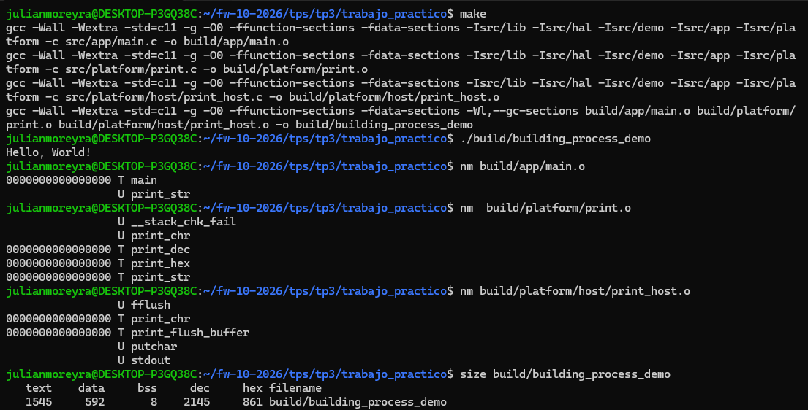


**Interpretaciones/Conclusiones/Respuestas**

- Un **símbolo** es un nombre que identifica, por ejemplo, una función o una
  variable. 
  `T` identifica código definido y visible para otros objetos, `t` identifica código definido local al objeto, `U` identifica un símbolo que el objeto necesita, pero no define.

- Los ceros de `nm` de los símbolos no son las direcciones finales del programa,
 indican la posición relativa al inicio de la sección donde está cada función. En este proyecto `-ffunction-sections` coloca cada función en una sección propia, por
  eso varias funciones pueden figurar en la posición cero. 

| Columna de size | Valor | Interpretación |
|-----------------|-------|----------------|
| `text` | 1545 bytes | 	Tamaño agrupado de código y otras secciones de solo lectura |
| `data` | 592 bytes | 	Tamaño agrupado de datos modificables almacenados en el ejecutable |
| `bss` | 8 bytes | 	Tamaño agrupado de datos inicializados a cero |
| `dec` | 2145 | Suma de las tres columnas anteriores, escrita en decimal |
| `hex` | 861 | Suma de las tres columnas anteriores, escrita en hexa |

> ### **`main.o` usa `print_str` pero no la define. ¿En qué objeto de `build/platform/` está?**
>  `print_str` está definida en **`build/platform/print.o`**, donde aparece como `T`. En `main.o` aparece como `U`. Y a su vez `print.o` necesita `print_chr`, `print_host.o`   la define. El linker enlaza las referencias o piezas del programa para formar el ejecutable final: `build/building_process_demo`.


## Hito 2

Primero vamos a agregar `-Werror` a `CFLAGS`, luego implementar `math_factorial` y `math_gcd` en `src/lib/mathlib.c`, agregar a `SRCS` y desde `main.c` imprimir. Por último con `nm build/lib/mathlib.o` verificar que las dos funciones aparecen como `T`.

| Comando | Para qué se usó |
|---------|----------------|
| `make clean` | Eliminar los archivos generados antes de reconstruir el proyecto después de cambiar `SRCS`. |
| `make` | Compilar los archivos pendientes de actualización y enlazar el programa. |
| `nm build/lib/mathlib.o` | Inspeccionar los símbolos definidos en el objeto de la biblioteca matemática. |
| `./build/building_process_demo` | Ejecutar las llamadas a las funciones y observar los resultados. |

Agregar `-Werror` a `CFLAGS` en el Makefile

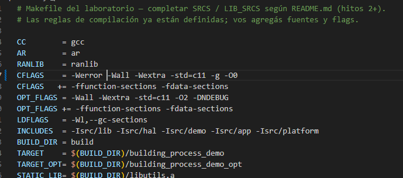

**Outputs obtenidos**

Primero observamos la salida del programa al implementar las funciones matemáticas y posteriormente agregadas `SRCS` pero sin modificar el `main.c`.

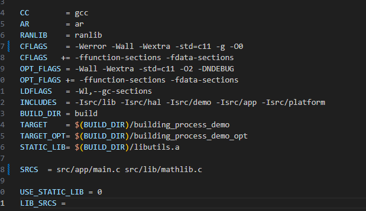
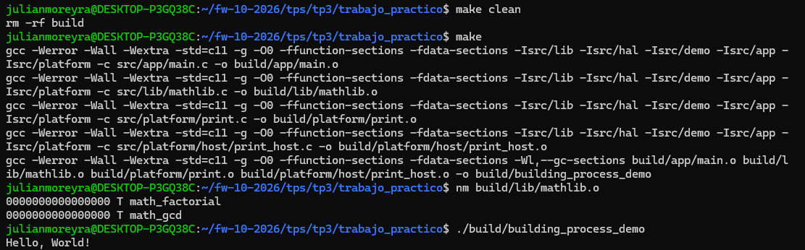

Acá se puede observar como se generó el objeto `mathlib.o` y se pasó al enlazador. Como main todavía no llama a sus funciones, la salida sigue siendo `Hello, World!`, las secciones no utilizadas pueden descartarse durante el enlace.

Vemos como al ejecutar el comando `nm build/lib/mathlib.o` el output que nos devuelve es de las dos funciones como símbolos `T`, es decir, están definidas en la sección de código del objeto y son visibles para otros objetos.

El siguiente paso fue modificar el `main.c` para ver la correcta implementación de las funciones matemáticas:

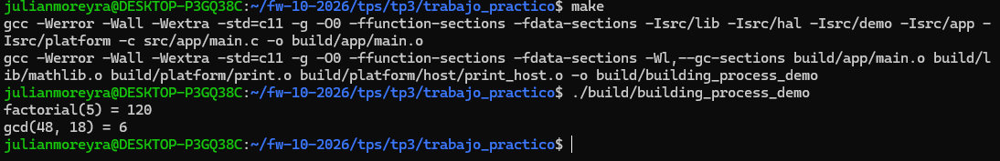

Se puede apreciar como al ejecutar el `make` no se volvieron a compilar todos los archivos `.c`, solamente aquellos que fueron modificados y el linker que los vuelve a agrupar. Vemos que el resultado es el esperado.

## Hito 3

Vamos a agregar `math_isqrt` (raíz cuadrada entera) y `math_is_prime` sin romper nada.

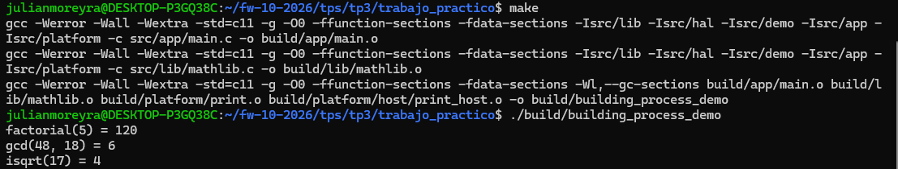
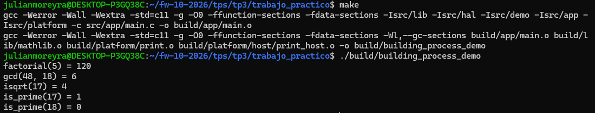

> - Vemos que en la primer captura al agregar las funciones en `mathlib.c` y modificar el `main.c` se vuelven a generar los archivos `.o` para el linker.
> - En la segunda captura solo se recompiló `main.c`. `mathlib.o` se reutilizó porque mathlib.c no había cambiado desde su compilación anterior. Después se volvió a enlazar el ejecutable.
> - Los resultados son los esperados.

## Hito 4

Se van a implementar las funciones `strbuf_*` de `src/lib/strutils.c` sin escribir más allá de `STR_MAX_LEN`. Con `strbuf_set` y `strbuf_append_int` vamos a armar e imprimir `value=42`.

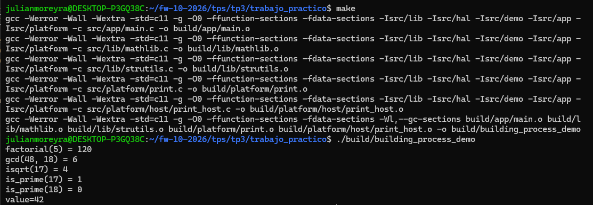

El procedimiento fue: 
- Implementar las funciones `strbuf_*` de `src/lib/strutils.c`.
- Modificar el main para su uso y agregar el header `#include "strutils.h"` para que el compilador conozca el tipo `strbuf_t` y las declaraciones de las funciones.
- Agregar al `SRCS` del `Makefile` el archivo ``src/lib/strutils.c`` que es donde están implementadas las funciones.
- Ejecutar un `make clean` porque cambiamos la lista `SRCS`.
- Ejecutar un `make` para compilar y enlazar todo.
- Ejecutar el `./build/building_process_demo` y observar la salida.

## Hito 5

Se van a implementar `str_trim` y `str_crc8` (que arranca en `STR_CRC8_INIT`). Se pide: 
- Recortar `"  hello  "`, calcular el CRC de `{0x01, 0x02, 0x03, 0x04}` e imprimir el CRC con `print_hex(crc, 2)`.

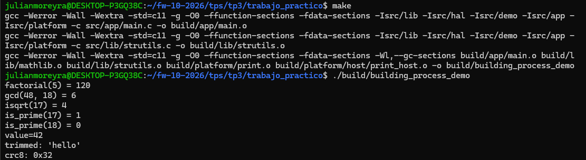

El procedimiento fue: 
- Implementar las funciones `str_trim` y `str_crc8`.
- Modificar el main para usar las funciones e imprimir los resultados.
- No se ejecuto un `make clean` ya que seguimos usando los mismos archivos fuente.
- Ejecutar un `make` para recompilar main.c y strutils.c, se reutilizaron los demás objetos y se volvió a enlazar.
- Ejecutar el `./build/building_process_demo` y observar la salida.

## Hito 6

Se llevo a cabo la implementación de la UART simulada en `src/hal/hal_uart.c`, posteriormente se inicializo a 115200 baudios, mandamos `"OK"` e imprimimos los registros con `print_hex(valor, 8)`.

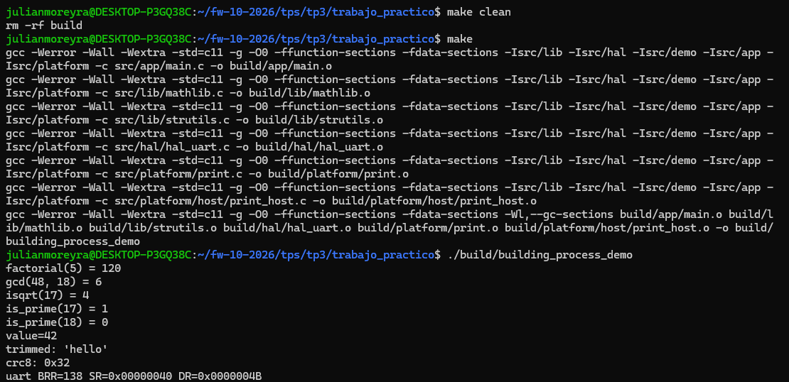

`BRR=138` corresponde a la división entera del reloj de `16 MHz` por `115200`. `SR=0x00000040` indica que quedó activado el bit 6, usado en este modelo para señalar transmisión completa. `DR=0x0000004B` conserva el código de `K`, el último carácter enviado.

El procedimiento fue: 
- Implementar la UART simulada en `src/hal/hal_uart.c`
- Modificar el main para su uso y agregar el header `#include "hal_uart.h"` para que el compilador conozca las declaraciones de las funciones.
- Agregar al `SRCS` del `Makefile` el archivo `src/hal/hal_uart.c` que es donde están implementadas las funciones.
- Ejecutar un `make clean` porque cambiamos la lista `SRCS`.
- Ejecutar un `make` para compilar y enlazar todo.
- Ejecutar el `./build/building_process_demo` y observar la salida.

## Hito 7

Se llevo a cabo la implementación de `ring_init`, `ring_push` y `ring_pop` que van en `src/hal/hal_ring.c`, posteriormente se encolaron de `'A'` a `'J'` y se desencolo todo e imprimió `ring: ABCDEFGHIJ`

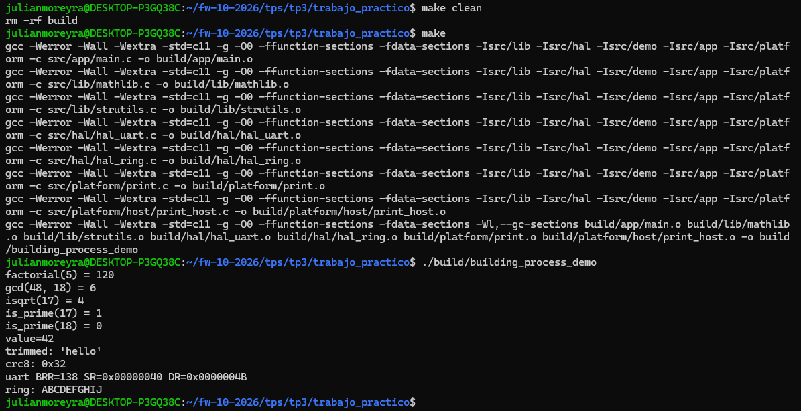

Las diez letras se recuperaron en el mismo orden en que se agregaron. Esto comprueba el comportamiento de cola: el primer dato que entra es el primero que sale.

El procedimiento fue: 
- Implementar las funciones en `src/hal/hal_ring.c`
- Modificar el main para su uso y agregar el header `#include "hal_ring.h"` para que el compilador conozca las declaraciones de las funciones.
- Agregar al `SRCS` del `Makefile` el archivo `src/hal/hal_ring.c` que es donde están implementadas las funciones.
- Ejecutar un `make clean` porque cambiamos la lista `SRCS`.
- Ejecutar un `make` para compilar y enlazar todo.
- Ejecutar el `./build/building_process_demo` y observar la salida.

## Hito 8 

Se llevó a cabo la implementación de un `timer` en `src/hal/hal_timer.c`

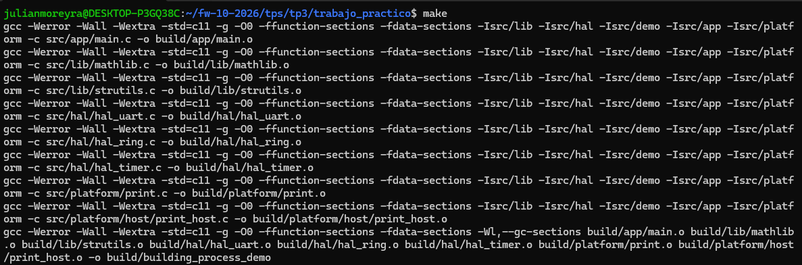
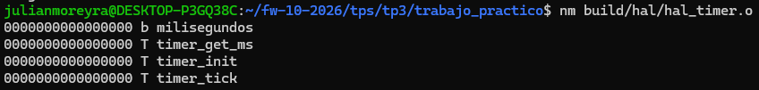

- Observamos en la primer captura la compilación de todos los archivos `.c` y la generación de sus respectivos archivos `.o`.
- Como no modificamos nada en el `main.c` ejecute el comando `nm` para `hal_timer.o` para observar los símbolo creados, podemos observar como cada una de las funciones están definidas como `T`, es decir, código. Pero, también existe otro símbolo, milisegundos aparece como `b`: es un dato local al objeto al estar declarado `static`, y pertenece a la sección de datos que se inicializan a cero.

El procedimiento fue: 
- Implementar las funciones en `src/hal/hal_timer.c`
- Agregar al `SRCS` del `Makefile` el archivo `src/hal/hal_timer.c` que es donde están implementadas las funciones.
- Ejecutar un `make clean` porque cambiamos la lista `SRCS`.
- Ejecutar un `make` para compilar y enlazar todo.

## Hito 9 

En `demo_embedded.c` armar una trama de 6 bytes: `0xAA` de sincronismo, el payload `{0x01, 0x02, 0x03, 0x04}` y al final el CRC-8 del payload. Pasar entera por el buffer circular y, del otro lado, validar que el primer byte sea `0xAA` y que el CRC recalculado coincida con el último. Imprimir `frame: ok crc=0x32`, o `frame: error` si algo no cierra. Después inicializar el timer, llamar tres veces a `timer_tick()` e imprimir `timer_ms: 3`.

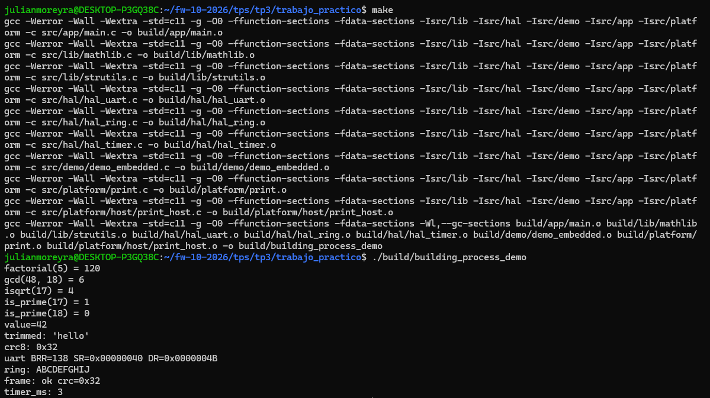

Este hito permitió integrar los módulos desarrollados por separado anteriormente. La trama pasó por el buffer circular y superó las comprobaciones de sincronismo y CRC. También se verificó que el temporizador acumula una unidad por llamada a `timer_tick()`.

El procedimiento fue: 
- Implementar `src/demo/demo_embedded.c`.
- Modificar el main para su uso y agregar el header `#include "demo.h"` para que el compilador conozca la declaración de la función `demo_embedded()`.
- Agregar al `SRCS` del `Makefile` el archivo `src/demo/demo_embedded.c` que es donde está implementada la función.
- Ejecutar un `make clean` porque cambiamos la lista `SRCS`.
- Ejecutar un `make` para compilar y enlazar todo.
- Ejecutar el `./build/building_process_demo` y observar la salida.

## Hito 10

Vamos a mover el código de prueba de los hitos 2 a 9 a `demo_math()`, `demo_str()` y `demo_embedded()`, agregar los tres archivos de `src/demo/` a `SRCS` y dejar en `main()` solo las tres llamadas. La salida tiene que quedar igual.

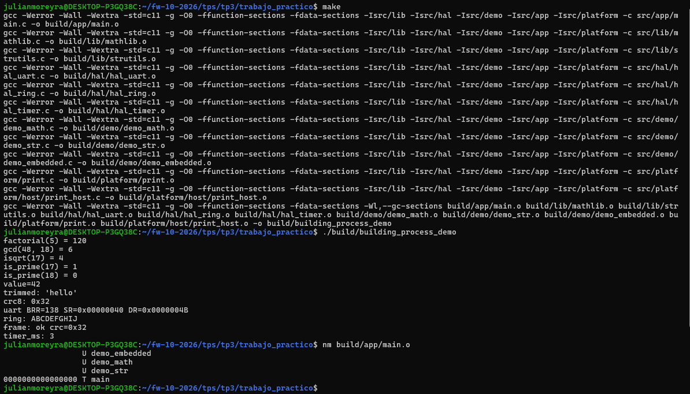

Entonces se distribuyeron las pruebas entre tres funciones tipo demo y se dejó main encargado de llamarlas. La salida se mantuvo igual, por lo que la reorganización conservó el comportamiento observado.

El procedimiento fue: 
- Implementar `src/demo/demo_embedded.c`, `src/demo/demo_math.c` y `src/demo/demo_str.c`.
- Modificar el main para su uso y agregar el header `#include "demo.h"` para que el compilador conozca las declaraciones de las funciones.
- Agregar al `SRCS` del `Makefile` el archivo `src/demo/demo_embedded.c`, `src/demo/demo_math.c` y `src/demo/demo_str.c`
- Ejecutar un `make clean` porque cambiamos la lista `SRCS`.
- Ejecutar un `make` para compilar y enlazar todo.
- Ejecutar el `./build/building_process_demo` y observar la salida.
- Los resultados obtenidos son los mismos que los que tuvimos con el anterior `main.c`

## Hito 11

Vamos a poner `USE_STATIC_LIB = 1` y pasar todas las fuentes de `lib/` y `hal/` de `SRCS` a `LIB_SRCS`, en `SRCS` quedan solo `app/` y `demo/`. Vamos a ejecutar los siguientes comandos: 

```bash
make clean && make
ar t build/libutils.a
nm --defined-only build/libutils.a
```

Observemos las salidas:

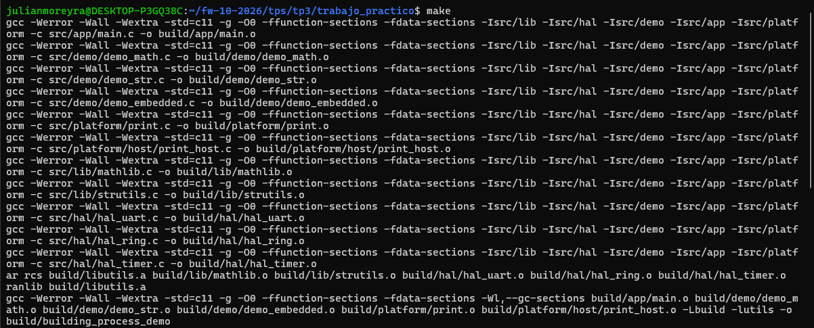

Se observa la compilación de las fuentes y la creación de `libutils.a` mediante
`ar rcs`, seguida de `ranlib`. En la última línea, los objetos de la aplicación,
las demostraciones y la plataforma se enlazan con la biblioteca usando
`-Lbuild -lutils`, en lugar de enumerar directamente los objetos de `lib/` y `hal/`.

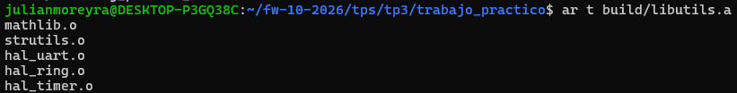

El comando `ar t` confirma que la biblioteca contiene los cinco objetos esperados:
`mathlib.o`, `strutils.o`, `hal_uart.o`, `hal_ring.o` y `hal_timer.o`. Son los
miembros del archivo `.a`.

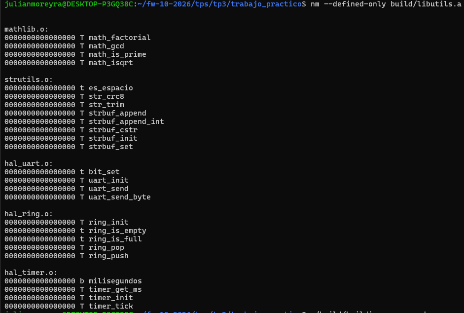

Se muestran los símbolos definidos, agrupados por el objeto que los contiene.

## Hito 12

Vamos a realizar una compilación optimizada del proyecto, lo haremos mediante el comando `make opt`. Luego compararemos `text`, `data` y `bss` de los dos ejecutables.

**`make opt`** ejecuta la regla `opt` definida en el Makefile: compila las fuentes con las opciones de `OPT_FLAGS`, entre ellas `-O2`, que activa optimizaciones del compilador.
Genera objetos con el sufijo `_opt.o` y los enlaza directamente para crear `build/building_process_demo_opt`. En esta regla se usan los objetos optimizados, no la biblioteca `libutils.a` construida con las opciones normales.

Veamos los comandos con sus salidas:

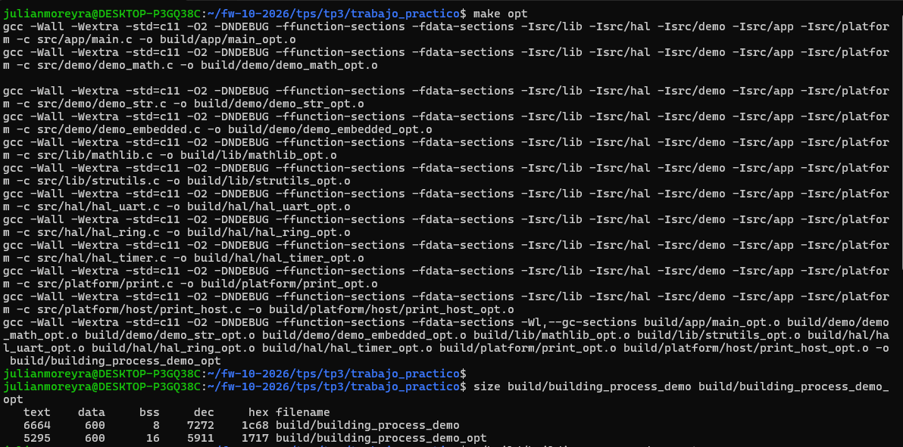

Se observa la generación de los objetos optimizados y su enlace. Después, `size`
permite comparar los tamaños agrupados de código y datos de ambos ejecutables.
Todos los tamaños de la siguiente tabla están expresados en bytes.

| Versión | `text` | `data` | `bss` | Total (`text + data + bss`) |
|:---------:|:-------:|:-------:|:------:|:--------------------------:|
| Normal| 6664 | 600 | 8 | 7272 |
| Optimizada| 5295 | 600 | 16 | 5911 |

**Interpretaciones/Conclusiones/Respuestas**

- **`text` disminuyó 1369 bytes** La optimización
  transformó el código generado: varias funciones ocupan menos y algunas
  funciones auxiliares dejaron de aparecer como funciones separadas.
- **`data` permaneció en 600 bytes.** En estas compilaciones, los cambios no
  alteraron el tamaño total de ese grupo de secciones con datos modificables
  almacenados en el ejecutable.
- **`bss` aumentó de 8 a 16 bytes.** La inspección adicional con `nm` y `readelf`
  mostró que la versión optimizada incorpora el símbolo `stdout`, asociado a la
  salida estándar, con 8 bytes. La versión normal referencia `putchar`, la
  optimizada referencia `putc` y `stdout`. El contador `milisegundos` sigue
  ocupando 4 bytes en ambas versiones: el aumento proviene del soporte de salida
  de la biblioteca de C, no de haber agrandado nuestro contador.
- Se compararon las dos configuraciones del Makefile, que además de `-O0` y
  `-O2` tienen otras diferencias: la normal usa `-g` para incluir información de
  depuración y la optimizada define `NDEBUG`. La información de depuración no se
  incluye en las tres columnas medidas por `size`, por lo que quitar `-g` no
  explica por sí solo la reducción de `text`.

> La versión optimizada redujo la suma medida por `size` de 7272 a 5911 bytes,
> conservando los outputs esperados. Optimizar no implica que todas las
> secciones se reduzcan: en este caso disminuyó `text`, `data` quedó igual y
> aumentó `bss`.

## Hito 13

Vamos a definir `PROGRAM_NAME` y `PROGRAM_VERSION` en `main.c`. Si el programa recibe `--version`, imprime nombre, versión y termina sin correr las demos. Vamos a chequear que las cadenas quedaron en el binario con los comandos:

```bash
./build/building_process_demo --version
strings build/building_process_demo | grep building-process
```

Observemos los outputs obtenidos:

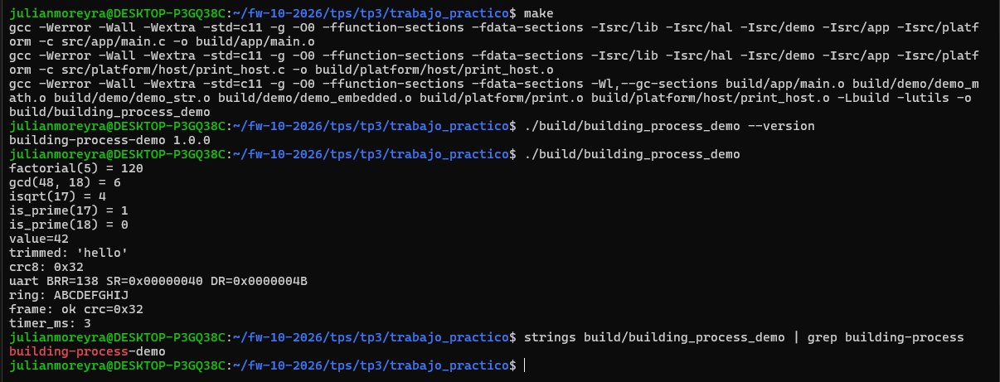

La captura muestra la recompilación de `main.c` y `print_host.c`, seguida del
enlace con `libutils.a`. Al ejecutar con `--version` aparece solamente
`building-process-demo 1.0.0`, sin esa opción se conservan las doce líneas de las
demostraciones. Finalmente, `strings` junto con `grep` encuentra el texto
`building-process-demo` dentro del ejecutable.

**Interpretaciones/Conclusiones/Respuestas**

- `PROGRAM_NAME` y `PROGRAM_VERSION` se definen mediante `#define`: antes de
  compilar, esos nombres se sustituyen por los textos `"building-process-demo"`
  y `"1.0.0"` donde se utilizan.
- `argc` indica la cantidad de argumentos, contando el nombre con el que se
  invocó el programa, `argv` contiene esos argumentos como textos. En esta
  ejecución, `argv[0]` corresponde al programa y `argv[1]` a `--version`.
- La condición `argc > 1` comprueba que exista un argumento adicional antes de
  comparar `argv[1]`. `strcmp`, declarada en `string.h`, compara dos textos y
  devuelve cero cuando son iguales.
- Si se reconoce `--version`, se imprimen el nombre y la versión y se ejecuta
  `return 0`, que termina el programa correctamente antes de llamar a las demos.
  Sin argumentos adicionales, se ejecutan `demo_math()`, `demo_str()` y
  `demo_embedded()` como antes.
- El resultado de `strings ... | grep building-process` confirma la presencia
  del nombre en el binario. Este filtro busca el nombre, no la versión: como el
  código imprime ambos textos por separado, `1.0.0` no tiene por qué aparecer en
  esa misma línea de la inspección. La ejecución con `--version` muestra ambos.

> Se agregó una opción para consultar el nombre y la versión sin ejecutar las
> demostraciones. Las pruebas mostraron que la opción produce la salida pedida
> y que la ejecución sin argumentos conserva los resultados anteriores.

## Hito 14

Se inspeccionó el ejecutable normal y los objetos del proyecto para responder
las cinco preguntas de la consigna. A continuación se registran las respuestas
y la evidencia de terminal obtenida durante esta etapa.

**Interpretaciones/Conclusiones/Respuestas**

> ### **1. Tres símbolos de `mathlib.o` y su tipo según `nm`.**

Se obtuvo:

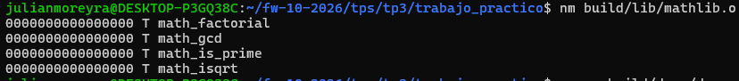

Tomando tres de ellos:

| Símbolo | Tipo | Interpretación |
|---------|------|----------------|
| `math_factorial` | `T` | Función definida en código y visible para otros objetos. |
| `math_gcd` | `T` | Función definida en código y visible para otros objetos. |
| `math_isqrt` | `T` | Función definida en código y visible para otros objetos. |

> ### **2. ¿Qué símbolos usa `demo_embedded.o` sin definirlos? ¿Dónde se resuelven?**

`nm -u` mostró los siguientes símbolos como `U`, es decir, usados pero no
definidos en el objeto inspeccionado. Al cruzarlos con las definiciones de la
biblioteca y de los objetos de plataforma, se obtiene:

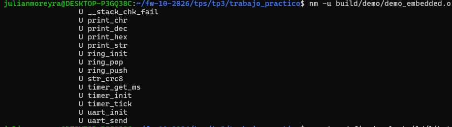

| Símbolos usados sin definir | Dónde se obtienen sus definiciones |
|----------------------------|----------------------------------|
| `print_chr` | `build/platform/host/print_host.o`. |
| `print_dec`, `print_hex`, `print_str` | `build/platform/print.o`. |
| `ring_init`, `ring_pop`, `ring_push` | Miembro `hal_ring.o` de `build/libutils.a`. |
| `str_crc8` | `strutils.o` de `build/libutils.a`. |
| `timer_get_ms`, `timer_init`, `timer_tick` | `hal_timer.o` de `build/libutils.a`. |
| `uart_init`, `uart_send` | `hal_uart.o` de `build/libutils.a`. |
| `__stack_chk_fail` | Biblioteca de C del sistema, enlazada mediante las herramientas de compilación. |


> ### **3. ¿Cuál es la sección más grande del ejecutable?**

Considerando todas las secciones del archivo, la mayor es **`.debug_info`**, con
**5779 bytes**. Si se consideran solamente las secciones que ocupan memoria
durante la ejecución, la mayor es **`.text`**, con **4082 bytes**.

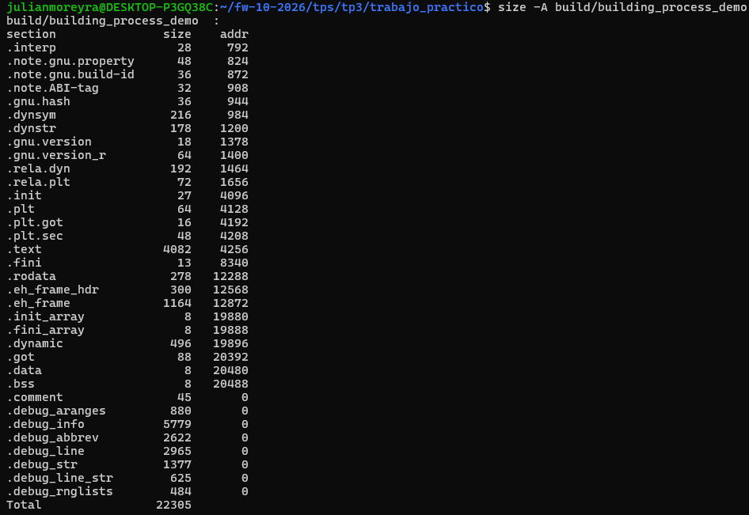

| Sección | Tamaño decimal (`size -A`) | Tamaño hexadecimal (`readelf` / `objdump`) | Significado |
|:---------:|:---------------------------:|:-----------------------------------------:|:-------------:|
| `.debug_info` | 5779 bytes | `0x1693` | Información utilizada para depurar el programa. |
| `.text` | 4082 bytes | `0xFF2` | Instrucciones de código del programa. |

La tabla de `readelf` marca `.text` con `A` (ocupa memoria durante la ejecución)
y `X` (contiene instrucciones ejecutables). `.debug_info` no tiene esas marcas:

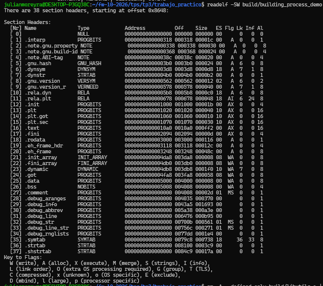

`objdump` la identifica como información de depuración. Esto permite distinguir
el contenido del archivo de las secciones necesarias en memoria para ejecutarlo. Ahí se ve que `.text` contiene código y ocupa memoria durante la ejecución, mientras que `.debug_info` contiene información para depurar y no tiene la propiedad `ALLOC`.

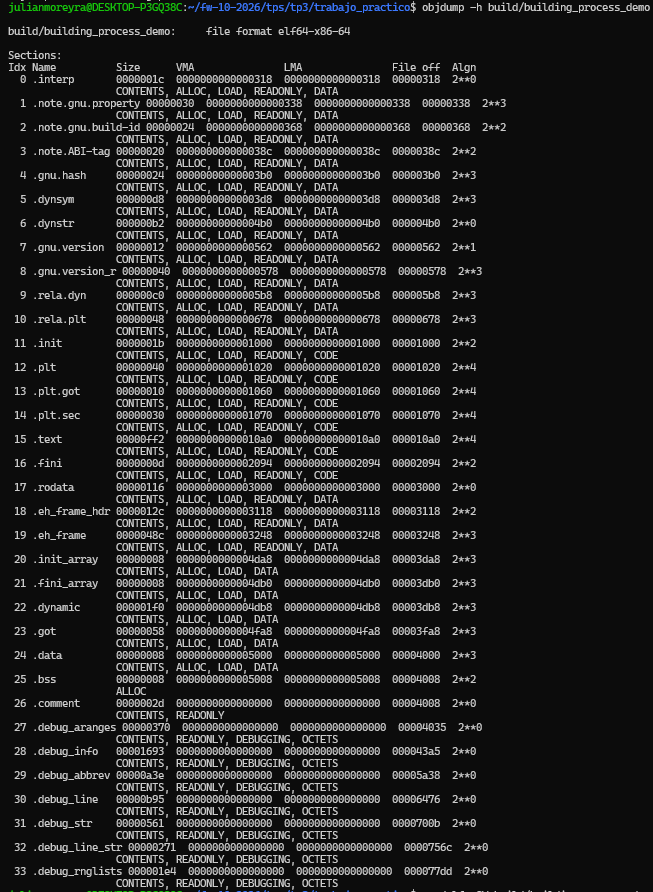

> ### **4. Después del hito 11, ¿en qué miembro de `libutils.a` está `math_factorial`?**

Está en **`mathlib.o`**, dentro de `build/libutils.a`.
La encontramos así:

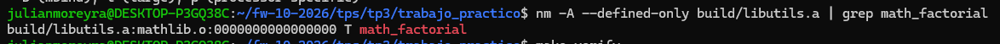

La salida identifica la biblioteca, el objeto que contiene la función y su tipo
`T`, que indica una definición de código global.

> ### **5. ¿Por qué la aplicación necesita `-lutils` para enlazar, pero `libutils.a` no necesita a la aplicación?**

La aplicación llama a funciones cuyas implementaciones están dentro de
`libutils.a`. En este Makefile, `-Lbuild` indica dónde buscar bibliotecas y
`-lutils` solicita usar `libutils.a` para resolver esas referencias. Si se quitara
esa biblioteca del enlace sin proporcionar las definiciones por otro medio,
aparecerían errores de referencias sin resolver.

La biblioteca se construye agrupando archivos objeto mediante `ar`. Crear un
archivo `.a` no requiere un `main` ni resolver todas las referencias de sus
miembros.

En este proyecto, las funciones de la biblioteca no llaman a las funciones de la aplicación. 
La dependencia va desde la aplicación hacia la biblioteca. 
Además, construir el archivo .a consiste en agrupar objetos y no exige resolver todas sus referencias

**Verificación final de entrega**

Se ejecutó `make verify` y se obtuvo el siguiente output:

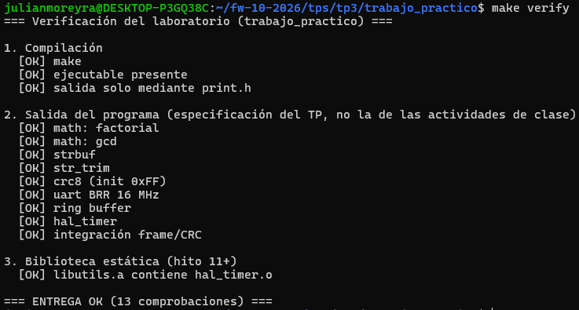
