# TP4 — Bootloader y arranque del firmware

En este práctico vamos a escribir un bootloader chico y usarlo para arrancar el
firmware del práctico anterior, todo en simulación. El BL arranca primero, hace
lo mínimo y le pasa el control al FW cargado, que tiene que correr igual que
antes.

### Hito 1 — Reconocimiento del arranque actual

1) A continuación veremos el output obtenido al ejecutar el comando `riscv64-unknown-elf-objdump -d build/standalone.elf`:

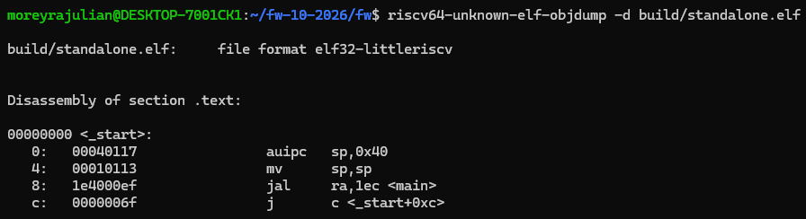

La primera línea de `fw.hex` contiene la codificación `00040117`, el desensamblado permite identificarla como la instrucción `auipc sp,0x40`, ubicada en la dirección  `0x00000000`: 

**`0:   00040117                auipc   sp,0x40`**

`_start` identifica el comienzo del código de arranque dentro de la sección de entrada `.text` de `startup.S`. En el enlace original queda en `0x0` porque el linker script ubica la sección de salida `.text` al comienzo de FLASH, cuyo origen es `0x0`, y recoge primero el código de `startup.S`. Al salir del reset, el PicoRV32 comienza a ejecutar en `0x0`, según la configuración del hardware, no consulta el símbolo `_start` ni la entrada del `ELF`.

Ahora observaremos el archivo `standalone.map` ubicado en `fw/build`, este nos ayudará a ver en que direcciones de memoria se ubicaron las secciones definidas por el linker. Primero veamos como quedó el mapa al linker primero `startup.S`:

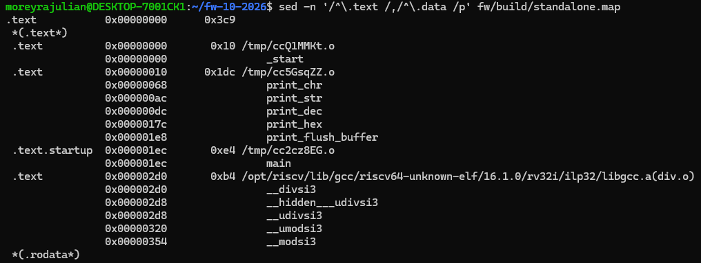

Observamos que `_start` comienza en la dirección `0x00000000`, como se esperaba.

Ahora observaremos el efecto de linkear primero `print.c` antes que `startup.S`, se podría suponer que se generará un desplazamiento dentro de la sección `.text` definida en el linker, provocando que la dirección de `_start` sea diferente a la `0x0`.
Realizaremos el linkeo en ese orden y mediante un `objdump` del archivo ELF generado analizaremos como se definió la sección `.text`:

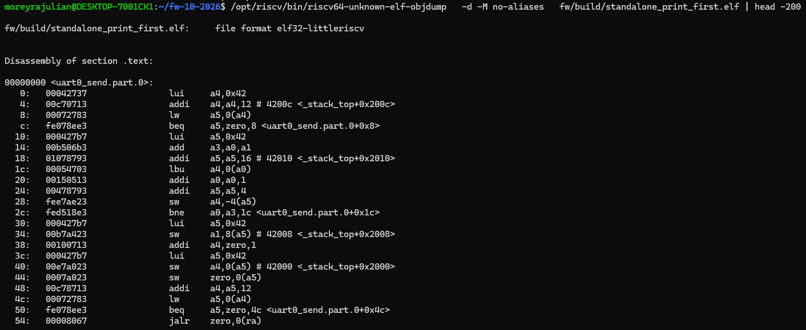
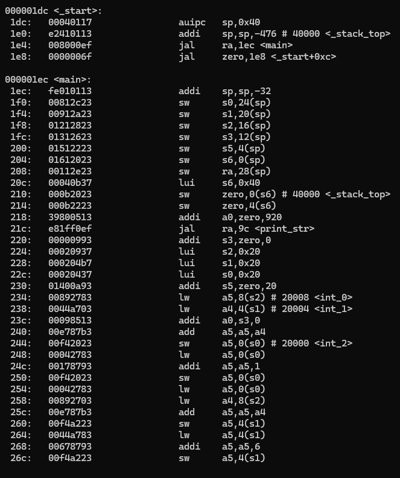

Confirmamos que al colocar `print.c` primero, la regla `*(.text*)` recoge su sección de código antes que la de `startup.S`. El código de UART ocupa el comienzo de la sección de salida `.text`, en `0x0`, y `_start` se desplaza a `0x1DC`. Esto no provocaría que el procesador busque las instrucciones allí ya que al salir del reset va a arrancar igualmente a partir de `0x0` encontrandose con código de la UART en lugar del de arranque.

2) Observamos la salida al linkear con `-Wl,--orphan-handling=warn`:

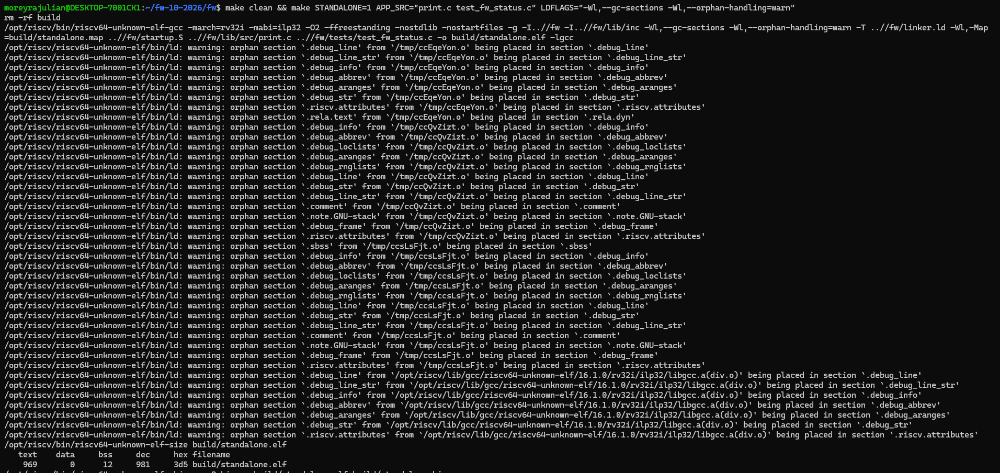

La opción `--orphan-handling=warn` hace que el linker advierta sobre las secciones de entrada que ninguna regla del script recoge explícitamente. El enlace continúa y el linker decide automáticamente su ubicación. En este caso, `.sbss` no coincide con el patrón `.bss*`, por lo que se trata como huérfana y se ubica en una sección de salida llamada `.sbss`.

Observando el archivo `standalone.map` ubicado en la carpeta `fw/build` podemos ver que las variables `int_0`, `int_1` e `int_2` se terminaron ubicando en la sección `.sbss`.

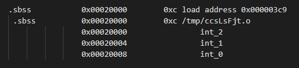

La sección `.sbss` ocupa `0xC` bytes desde la dirección `0x00020000` de RAM. Contiene las variables `int_2`, `int_1` e `int_0`, ubicadas en `0x00020000`, `0x00020004` y `0x00020008`, respectivamente.

3) Podemos notar que faltan 4 pasos intermedios: 

- `Copiar .data de Flash a RAM`
- `Poner .bss en cero`
- `Configurar el clock/PLL`
- `Llamar inicializadores de C++`

El startup omite la copia de `.data` a RAM y la puesta en cero de las variables de `.bss`, incluidas las que quedaron en `.sbss`. En este build no hay datos inicializados que requieran la copia, mientras que la inicialización del simulador puede ocultar la ausencia del borrado de `.sbss`. La configuración de clock/PLL no es necesaria para esta prueba porque el testbench genera el clock y se lo entrega al circuito simulado. Tampoco se requieren inicializadores de C++ porque este programa no utiliza constructores globales de ese lenguaje.

Observar `REG_FW_STATUS = 0xFF` indica que el programa alcanzó la instrucción que señala la finalización de la prueba al testbench. No demuestra que el arranque haya sido correcto: el test no comprueba los valores iniciales de las globales ni compara sus resultados con valores esperados

### Hito 2 — Vector table e init mínimo del BL

Vamos a implementar en `bootloader/bl_start.S` la vector table:

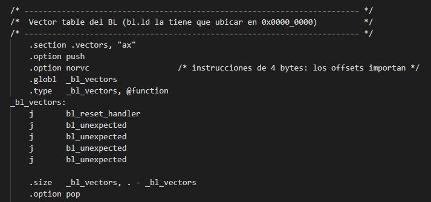

En `bl_reset_handler` cargar `sp` y llamar a `bl_main()`:

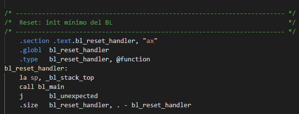

Y por último escribir el `bootloader/bl.ld`:

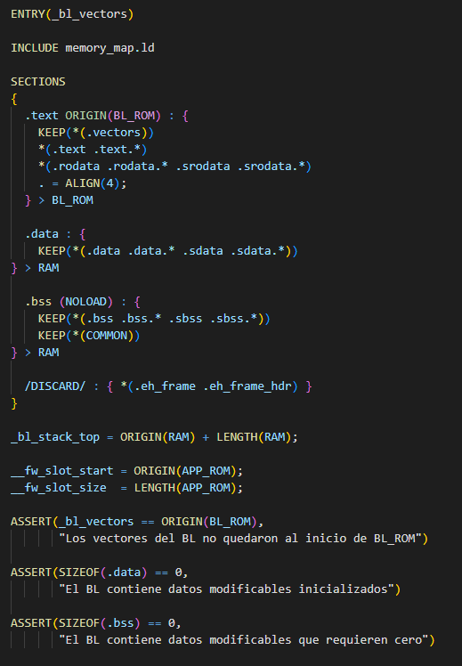

Comprobamos que el Entry quede en `0x0` y la vector table en `0x00, ..., 0x10`:

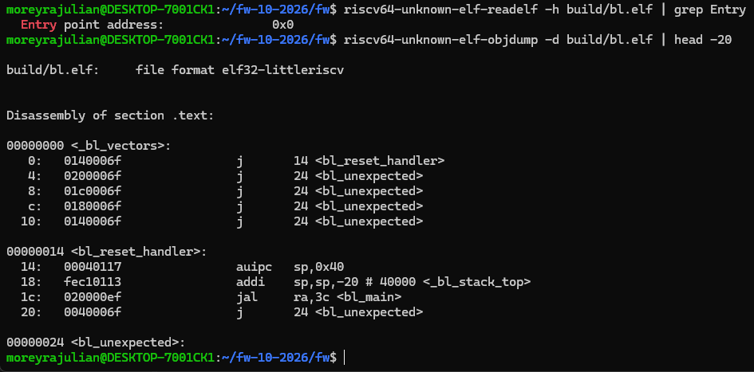

El ELF del bootloader declara su entrada en `0x0`, donde se ubicó `_bl_vectors`. El desensamblado confirma el salto de reset en `0x00` y el salto al manejador de error en `0x10`. El handler de reset carga `sp = 0x40000` antes de llamar a `bl_main`. El enlace terminó correctamente y `size` mostró tamaños cero para `data` y `bss`, en concordancia con las restricciones del linker script. Estas comprobaciones validan estáticamente la estructura de arranque del BL, todavía no verifican la ejecución de una aplicación.

### Hito 3 — El FW del TP anterior relinkeado en `0x1000`

En este hito completamos el linker script de la aplicación para ubicar su imagen en `APP_ROM`, desde `0x1000`. La cabecera se conserva mediante KEEP y se coloca antes del código. También definimos la distribución de `.data`, con dirección de ejecución en RAM y valores iniciales en `APP_ROM`, y de `.bss`, que ocupa RAM sin aportar valores iniciales a la imagen. Los símbolos definidos permiten que el startup conozca los intervalos que deberá copiar o poner en cero.

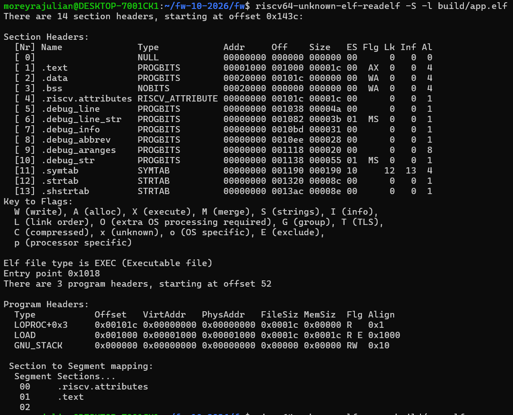

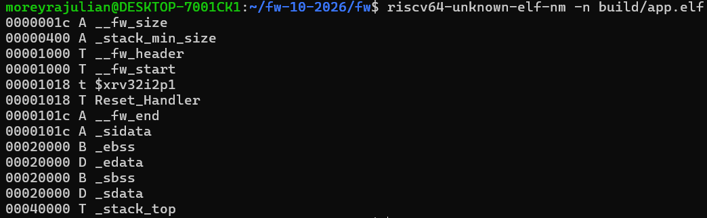

La inspección del ELF confirmó que `__fw_start` y `__fw_header` están en `0x1000`, mientras que `Reset_Handler` y la entrada del ELF están en `0x1018`. La imagen provisional ocupa 28 bytes. Las secciones `.data` y `.bss` están vacías porque el startup aún no referencia main.

### Hito 4 — Header y arranque del FW ("De 0 a main")

Completamos la cabecera de la aplicación y su `Reset_Handler`. El startup prepara el stack, copia los valores iniciales de `.data`, pone en cero `.bss` y llama a main. Si la función retorna sin haber señalado éxito mediante `REG_FW_STATUS = 0xFF`, ejecuta `ebreak`.

El build generó correctamente la imagen combinada. El empaquetador informó un stack inicial de `0x40000` y una entrada de la aplicación en `0x1018`. La aplicación ocupa `1108` bytes de imagen y requiere doce bytes de `.bss` en RAM. Esta comprobación valida la construcción y el empaquetado:

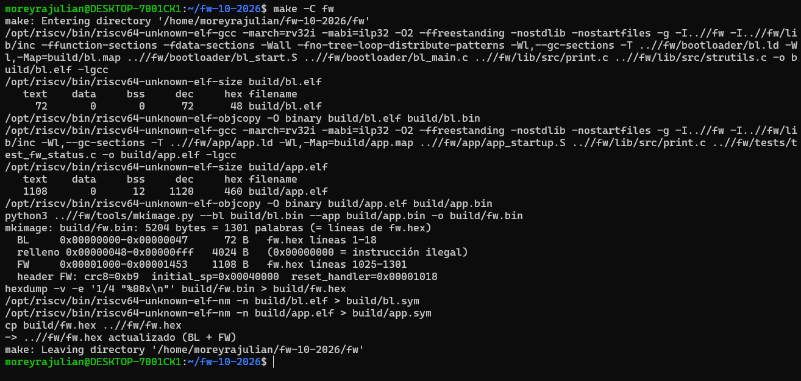

### Hito 5 — El salto del BL al FW

Implementamos la transferencia de control desde el bootloader hacia la aplicación. `bl_main` obtiene de la cabecera el stack inicial y la dirección de entrada, y los entrega a `bl_jump`. Según la ABI utilizada, los argumentos llegan en `a0` y `a1`, la rutina carga sp y salta a la aplicación sin establecer un nuevo retorno al BL.

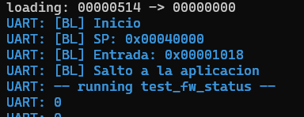

La simulación mostró primero los mensajes del bootloader, con `SP = 0x40000` y entrada `0x1018`, y después los mensajes de `test_fw_status.c`. Finalizó con `REG_FW_STATUS = 0xFF`, confirmando que la aplicación se ejecutó mediante el nuevo flujo de arranque. Quedan pendientes las pruebas específicas de inicialización de memoria y la validación de imágenes.

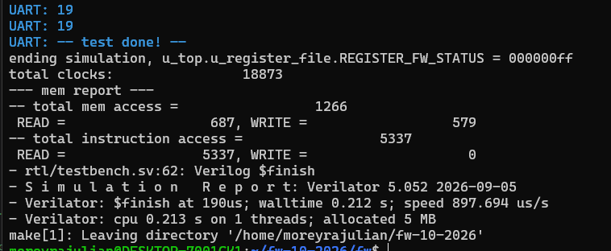

### Hito 6 — Verificar `.data` y `.bss`

Ejecutamos `test_data_bss.c` con el arranque TP4 y con el arranque standalone. 

Con el arranque TP4, `tp4_data_word`, ubicada en `0x20010`, tenía el valor esperado `0x1234ABCD`, el test terminó con `PASS` y `REG_FW_STATUS = 0xFF`.

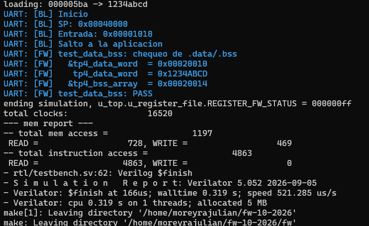

Con el arranque standalone, la misma variable contenía cero. El startup original prepara el stack y llama a main, pero no copia a RAM los valores iniciales almacenados en la imagen. Por eso fallan las comprobaciones de datos inicializados. La comprobación de ceros en .bss es menos concluyente en este entorno porque la RAM simulada comienza en cero.

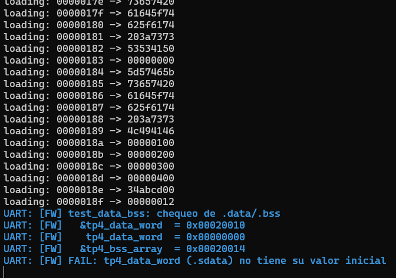

En la primera ejecución standalone, la waveform mostró que el firmware
escribió `REG_FW_STATUS = 0xBAD` y activó la señal `trap` del procesador.
Sin embargo, la simulación no terminó automáticamente y fue necesario
interrumpirla. La señal `trap` que consultaba el testbench estaba
desconectada de la salida del procesador.

Para corregir esta observación del error, agregamos en `rtl/testbench.sv`:

    assign trap = u_top.u_picorv32.trap;

Esta conexión permite que el testbench observe el trap generado por el
PicoRV32. Escribir `0xBAD` no basta para finalizar la simulación: el
testbench espera que el estado sea `0xFF` o que se active `trap`.
Cuando el test detecta errores, escribe `0xBAD` y ejecuta `ebreak`;
con la conexión corregida, el testbench detecta el trap y llega a
`$finish`.

Repetimos ambas pruebas. En standalone se observaron los fallos de
`tp4_data_word` y `tp4_data_array`, seguidos de `test_data_bss: FAIL`
y `TRAP!` a los 15997 ciclos. Esta vez la simulación finalizó
automáticamente.

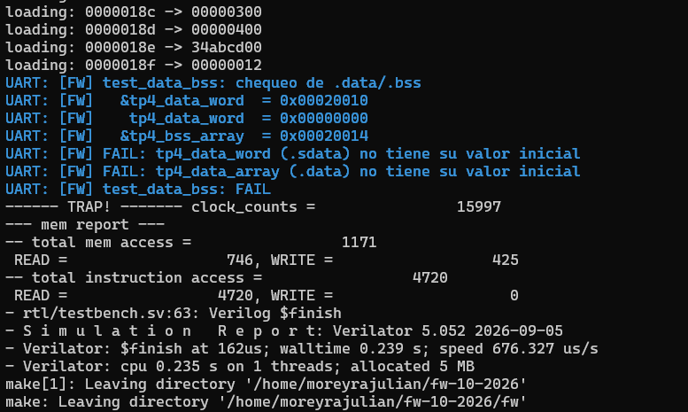

La prueba con bootloader y arranque TP4 volvió a terminar con
`test_data_bss: PASS` y `REG_FW_STATUS = 0xFF`, a los 16520 ciclos.

La comparación demuestra por qué es necesario preparar la memoria
antes de llamar a `main`: ubicar los valores iniciales en la imagen
no hace que aparezcan automáticamente en las direcciones de RAM
donde el programa utiliza las variables. El startup de la aplicación
realiza esa copia; el startup standalone original la omite.

Las comprobaciones de `.bss` también resultaron satisfactorias con
el arranque TP4. Sin embargo, como la RAM simulada comienza en cero,
este resultado por sí solo no demuestra que se haya ejecutado su
borrado. La evidencia decisiva de esta comparación es la recuperación
de los valores iniciales de `.data`.

### Hito 7 — Validar la imagen antes de saltar

Implementamos las validaciones de la imagen antes de transferirle el
control. El bootloader comprueba, en orden, el identificador `magic`,
la dirección de carga, el tamaño, el CRC, el stack inicial y la dirección
de entrada.

El tamaño se valida antes de calcular el CRC para limitar el recorrido
de memoria al espacio reservado para la aplicación. El CRC se calcula
desde el offset `0x10` hasta el final de la imagen, incluyendo el stack
inicial, la dirección de entrada, el código, las constantes y los valores
iniciales de `.data`. Se utiliza el mismo algoritmo que el empaquetador:
CRC-8 con polinomio `0x07` y valor inicial `0xFF`.

También implementamos `bl_fail()`, que imprime el motivo por UART,
registra el código de error, escribe `REG_FW_STATUS = 0xBAD` y llama
a `bl_halt()`. Esta última rutina ejecuta `ebreak`, permitiendo que
el testbench detecte el trap y finalice la simulación.

Para comprobar el rechazo de una imagen alterada ejecutamos
`make sim CORRUPT=1` desde `fw/`. El empaquetador calculó un CRC de
`0xB9` y luego invirtió el bit 0 del byte ubicado en `0x1232`,
sin actualizar el CRC almacenado. El resultado de la ejecución fue:

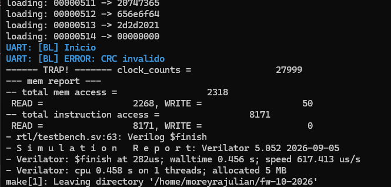

Durante la ejecución se observaron los mensajes `[BL] Inicio` y
`[BL] ERROR: CRC invalido`, seguidos de `TRAP!` a los 27999 ciclos
y de la finalización mediante `$finish`. No apareció el mensaje
de salto ni la salida de la aplicación.

Esta prueba confirma que el bootloader detecta la alteración introducida
y detiene el arranque antes de ejecutar la aplicación. No comprueba
individualmente todas las ramas de error: las validaciones del stack
y de la entrada no se alcanzan en esta ejecución porque el CRC falla antes.

También comprobamos el comportamiento con una imagen sin corrupción.
El bootloader informó un stack inicial de `0x40000` y una entrada
en `0x1018`, y luego mostró el mensaje de salto a la aplicación.
A continuación se ejecutó `test_fw_status.c`, que terminó con
`REG_FW_STATUS = 0xFF` a los 45238 ciclos. La simulación finalizó
mediante `$finish`.

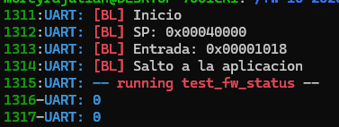

Esta ejecución confirma que la imagen utilizada supera todos los
controles implementados y puede arrancar mediante el bootloader.
En conjunto, las dos pruebas muestran la aceptación de una imagen
válida y el rechazo de la imagen alterada antes de ejecutarla.

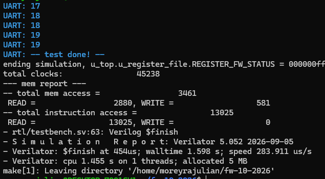

### Hito 8 — Revisar la memoria y matchear con el HEX (diapo 12)

Contrastamos el mapa del linker, el ELF, el HEX y la carga del simulador usando `test_data_bss.c`, sin corrupción:

```bash
make -C fw sim STANDALONE=0 CORRUPT=0 APP_SRC="print.c test_data_bss.c"
```

Los valores siguientes corresponden a esta construcción; cambiar la aplicación puede modificar tamaños y CRC.

**1. Ubicar el BL y el header en el HEX y los mapas**

Cada línea del HEX contiene cuatro bytes: la línea N corresponde a la dirección `4 × (N − 1)`.
- La línea 1 contiene `0140006f` en `0x0`; 
- La 1025 contiene `46345054` en `0x1000`.
- `bl.map` confirma `_bl_vectors = 0x0` y `__fw_slot_start = 0x1000`; 
- `app.map` ubica `__fw_start` y `__fw_header` en `0x1000`.

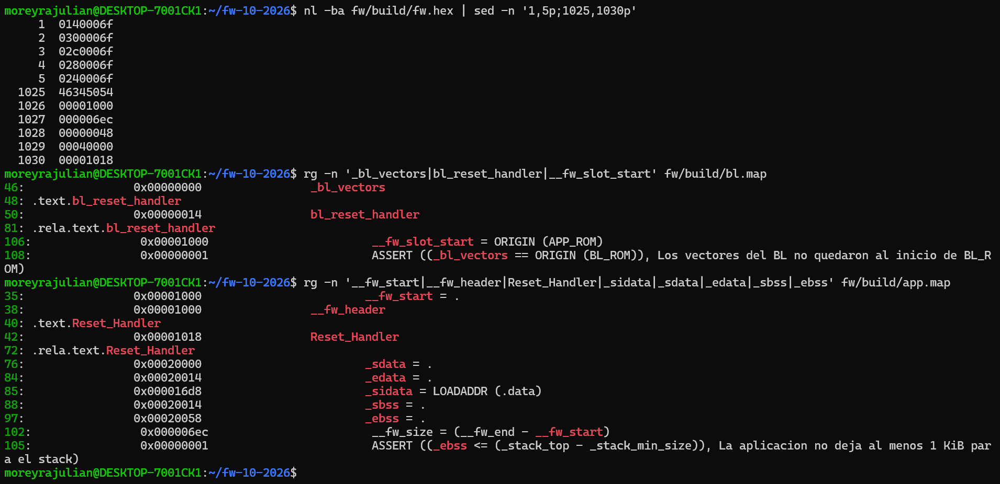

El BL ocupa `[0x0, 0x574)`, el relleno llega a `0x1000` y la aplicación ocupa `[0x1000, 0x16EC)`.
Los intervalos excluyen su límite final: la aplicación tiene `0x6EC = 1772` bytes y termina en el byte `0x16EB`.

**2. Inspeccionar la vector table y el header con objdump**

`objdump -d fw/build/bl.elf` mostró las mismas codificaciones que las primeras cinco líneas del HEX:

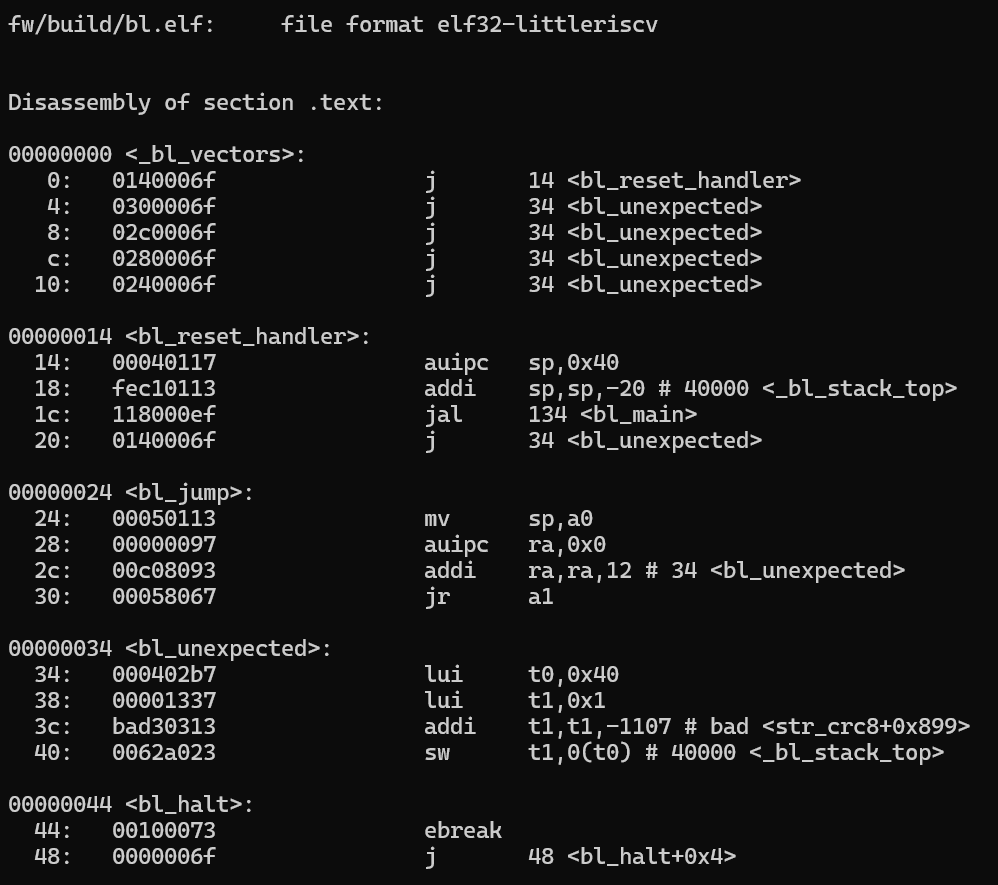

El reset salta a `0x14`.
Como vimos en el hito 2, son instrucciones que ejecuta el core. Los saltos al mismo destino tienen desplazamientos distintos según su ubicación.
Para el header usamos `objdump -s -j .text --start-address=0x1000 --stop-address=0x1018 fw/build/app.elf`:

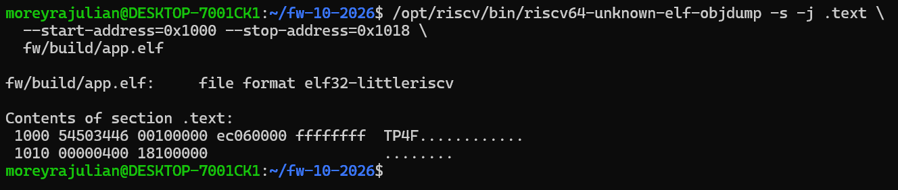

Estos son bytes consecutivos: en little endian, `54 50 34 46` representa `0x46345054` y `18 10 00 00` representa `0x1018`.
El header del HEX, desde la línea 1025, coincide con el ELF salvo por el CRC:

| Dirección | Campo | Valor en HEX |
|---|---|---|
| `0x1000` | `magic` | `0x46345054` |
| `0x1004` | `load_addr` | `0x1000` |
| `0x1008` | `image_size` | `0x6EC` |
| `0x100C` | `image_crc` | `0x48` |
| `0x1010` | `initial_sp` | `0x40000` |
| `0x1014` | `reset_handler` | `0x1018` |

El ELF conserva `0xFFFFFFFF` en `image_crc`: `mkimage.py` escribe el CRC después del enlace, sin modificar el ELF.
Como en el hito 7, el CRC cubre `[0x1010, 0x16EC)`, excluyendo el campo donde se guarda su resultado.

**3. Relacionar la entrada del header con Reset_Handler**

La línea 1030 del HEX corresponde a `0x1014` y contiene `0x1018`: ubicación del campo y destino son direcciones diferentes.
`nm` muestra `00001018 T Reset_Handler` y `readelf -h` informa `Entry point address: 0x1018`.
Los tres coinciden.

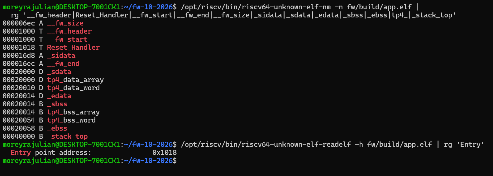

**4. Comprobar .data y .bss con readelf, nm y la ejecución**

`readelf -SW -lW` identifica `.data` como `PROGBITS`, de 20 bytes, y `.bss` como `NOBITS`, de 68 bytes.
El segmento que contiene ambas secciones tiene `VirtAddr = 0x20000`, `PhysAddr = 0x16D8`, `FileSiz = 0x14` y `MemSiz = 0x58`.
En este enlace, la VMA indica el destino de `.data` en RAM y la LMA su origen en APP_ROM; hay 20 bytes almacenados y 88 reservados en RAM (`20 + 68`).

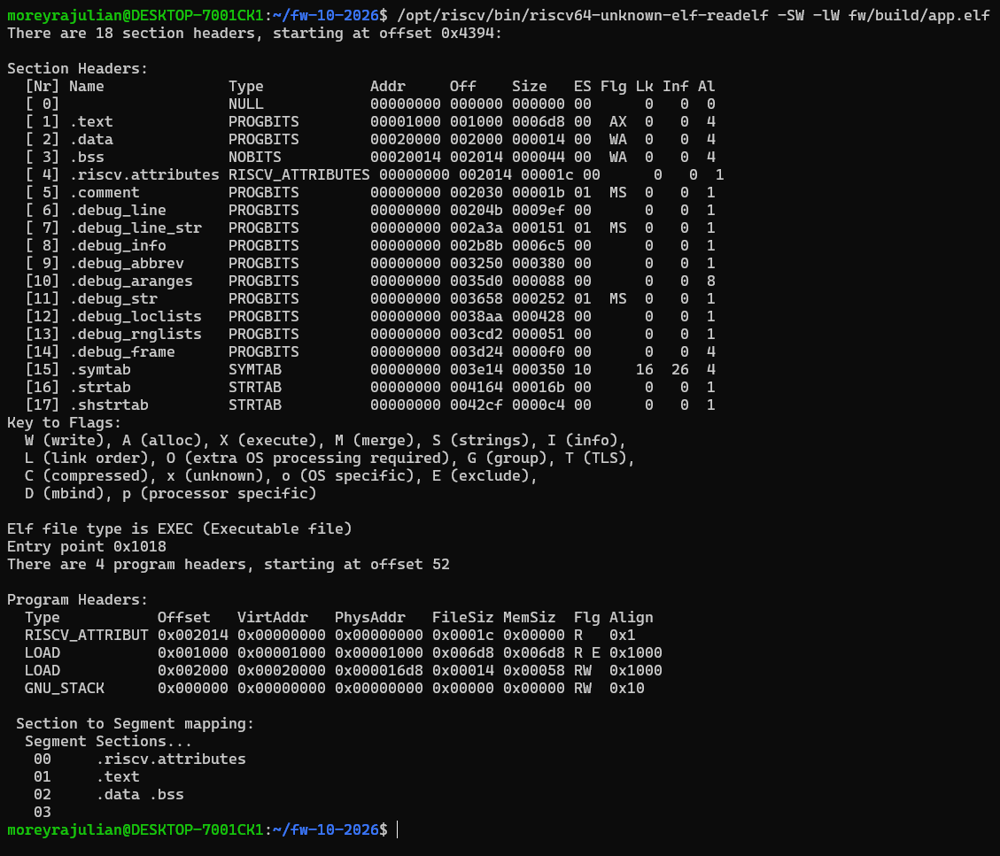

| Símbolos según nm | Valores | Función |
|---|---|---|
| `_sidata` | `0x16D8` | Origen de los valores iniciales |
| `_sdata`, `tp4_data_array`; `tp4_data_word` | `0x20000`; `0x20010` | Variables inicializadas en RAM |
| `_edata`, `_sbss`, `tp4_bss_array` | `0x20014` | Fin de .data e inicio de .bss |
| `tp4_bss_word`; `_ebss` | `0x20054`; `0x20058` | Última variable y fin de .bss |

El startup copia `[0x16D8, 0x16EC)` a `[0x20000, 0x20014)` y pone en cero `[0x20014, 0x20058)`.
Así, `__fw_end = 0x16EC` y `__fw_size = 0x16EC − 0x1000 = 0x6EC`, coincidiendo con el header.
El log muestra `loading: 000005ba -> 1234abcd`: el índice de palabra `0x5BA` corresponde a `0x16E8`, origen del inicializador de `tp4_data_word`.
La aplicación imprime su destino `0x20010`, el valor `0x1234ABCD` y `test_data_bss: PASS`; termina con `0xFF` a los 58821 ciclos.
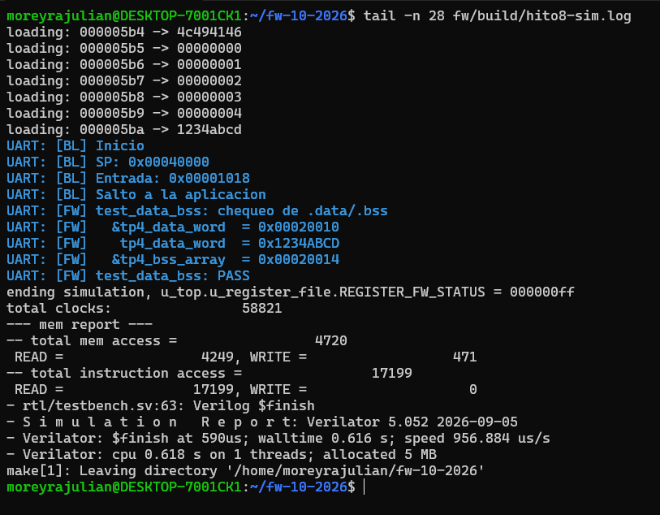
Esto vincula la distribución del hito 3 con la copia del hito 4. El testbench carga el HEX; el startup prepara la RAM.
Como advertimos en el hito 6, ver `.bss` en cero no demuestra por sí solo su borrado: la RAM simulada ya comienza en cero.

**5. Comparar el HEX con la carga del simulador**

Ejecutamos `make -C fw check | tee fw/build/hito8-check.log`, que compara el HEX con `sim.log` y consulta los símbolos de ambos ELF:

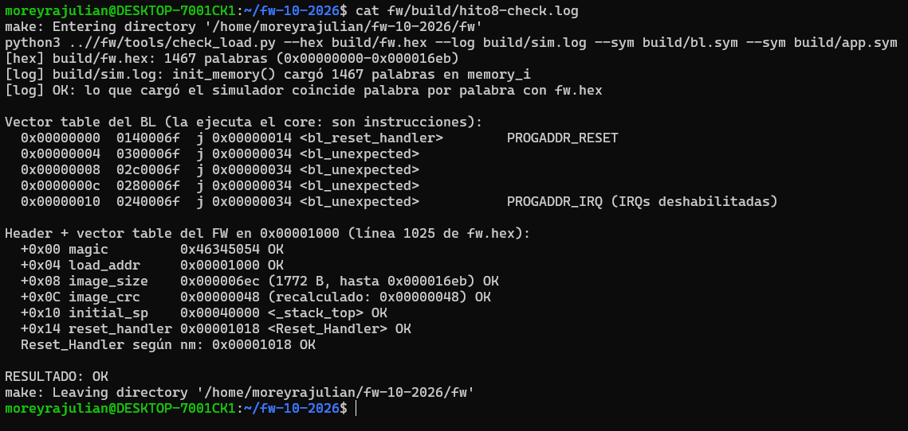

Las 1467 palabras abarcan 5868 bytes: BL, relleno y aplicación. La herramienta también verificó los restantes campos del header.
La comparación demuestra la coincidencia entre la imagen y la carga informada; el PASS aporta evidencia posterior de ejecución e inicialización.
Quedan relacionados el mapa del linker, los datos del ELF, las palabras del HEX y el comportamiento observado en simulación.

### Hito 9

1. **¿Por qué la tabla del BL contiene instrucciones y la de Cortex-M direcciones?**
   PicoRV32 comienza ejecutando la instrucción ubicada en la dirección de reset; por eso colocamos saltos. En Cortex-M, el hardware interpreta las primeras palabras como el SP inicial y la dirección del handler de reset.

2. **¿Qué hace el Makefile?** Compila y enlaza BL y aplicación con sus respectivos scripts, genera los mapas y símbolos, convierte cada ELF a binario con `objcopy`, combina las imágenes con `mkimage.py`, genera el HEX y lo instala para el testbench. `sim` ejecuta la simulación y `check` compara la carga con el HEX.
   - Se enlazan por separado porque el BL comienza en `BL_ROM` y la aplicación en `APP_ROM`, y cada uno tiene su propio arranque y distribución de memoria.
   - `objcopy -O binary` coloca los valores iniciales de `.data` según su LMA en `APP_ROM`; su VMA en RAM se usa durante la ejecución.
   - `mkimage.py` agrega relleno entre el final del BL y `0x1000`, y escribe el CRC en la cabecera de la aplicación.

3. **¿Por qué difiere la palabra en `0x100C`?** `app.elf` conserva el marcador `0xFFFFFFFF`; `mkimage.py` calcula el CRC después del enlace y lo escribe en la imagen combinada. En el hito 8, el HEX contiene `0x48`.

4. **¿Qué instrucciones cambian al relinkear?** En `uart0_send.part.0`, el `lui a4,0x42` tiene codificación `00042737` tanto en `0x10` (standalone) como en `0x108C` (aplicación). El salto interno `beqz` también conserva `fe078ee3`: se desplazaron tanto la instrucción como su destino, manteniendo la misma distancia. En cambio, para cargar el mismo stack `0x40000`, el startup standalone usa `auipc sp,0x40` en `0x0` y el de la aplicación usa `auipc sp,0x3f` en `0x1018`, seguido de distintos ajustes: el cálculo es relativo al PC. Los startups también cumplen funciones diferentes y el flujo TP4 agrega un header; no todas las diferencias se deben únicamente al relinkeo.

   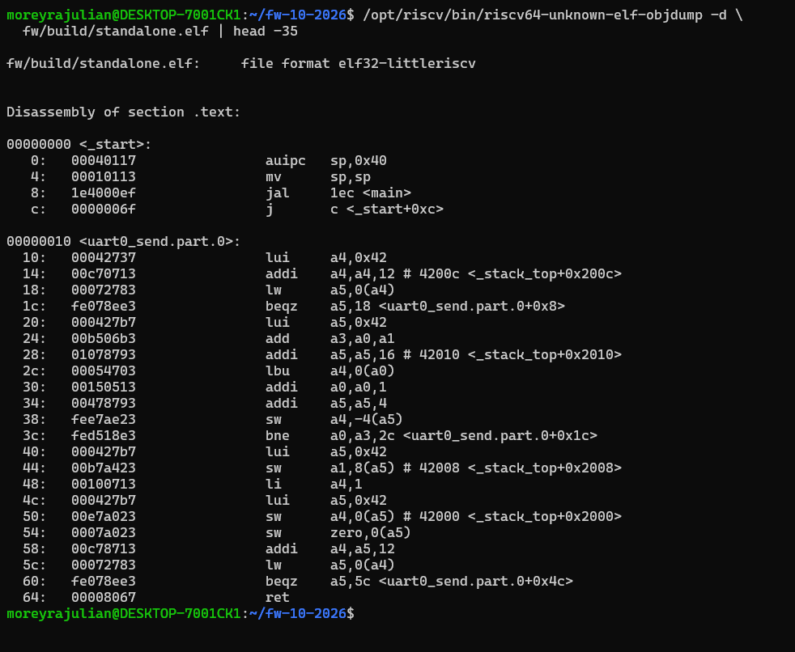

   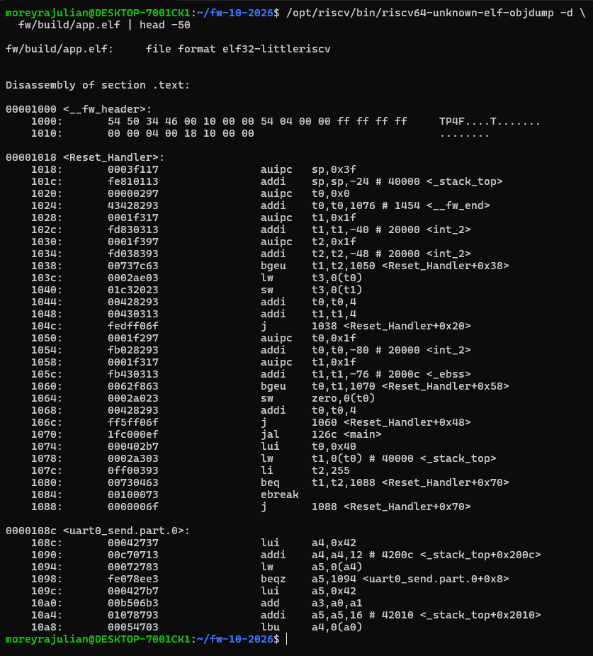

5. **¿Por qué `jr` y por qué recargar `sp`?** `jr` transfiere el control sin generar un retorno al BL; se deja `bl_unexpected` en `ra` por si ocurre un retorno inesperado. La aplicación recarga `sp` para establecer explícitamente su propio entorno, aunque en este flujo el BL ya le entregó el mismo valor.

6. **¿Por qué no escribir `0xFF` en el BL y por qué `0xBAD` no alcanza?** El testbench interpreta `0xFF` como fin exitoso, antes de que la aplicación se ejecute. `0xBAD` informa el error, pero no termina la espera; `bl_halt()` ejecuta `ebreak`, el core activa `trap` y el testbench finaliza.

7. **¿Qué funciones de `strutils` quedan en el BL?** `nm` muestra `str_crc8` en `bl.elf`. Es la función utilizada para validar la imagen; `-ffunction-sections` y `--gc-sections` permiten descartar funciones no referenciadas. La implementación local actual de `strutils.c` contiene únicamente `str_crc8`.

8. **¿Qué ocurre sin `.option norvc` con RV32IC?** El ensamblador podría usar saltos comprimidos de dos bytes. Las instrucciones siguientes quedarían desplazadas. `norvc` fuerza instrucciones de cuatro bytes en esa tabla y conserva los offsets.

### Entrega

La imagen corrompida produjo `ERROR: CRC invalido`, trap y `$finish` a los 27999 ciclos:

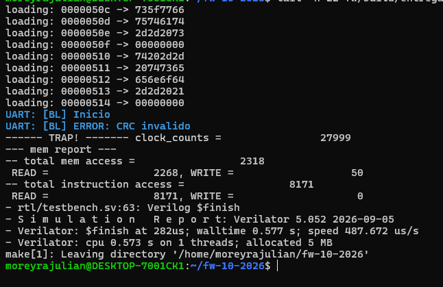

La imagen válida ejecutó `test_fw_status.c` y terminó con `REG_FW_STATUS = 0xFF` a los 45238 ciclos:

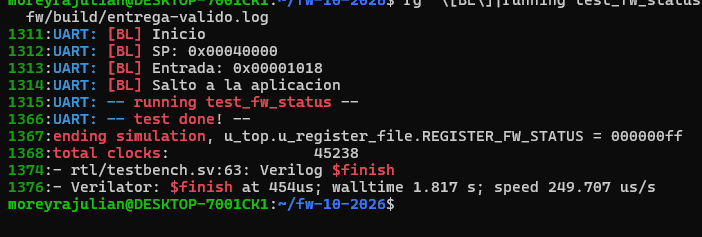

`make -C fw check` comparó 1301 palabras, verificó el header y terminó con `RESULTADO: OK`:

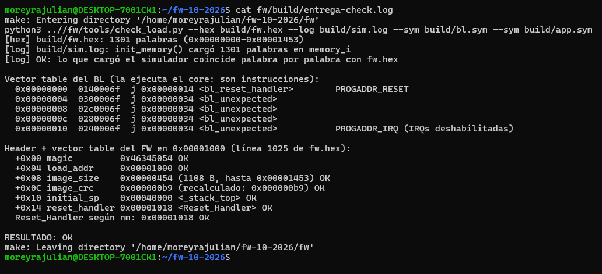

Los logs guardados son [válido](../../tps/tp4/logs/entrega-valido.log), [corrupto](../../tps/tp4/logs/entrega-corrupto.log) y [comprobación](../../tps/tp4/logs/entrega-check.log).
