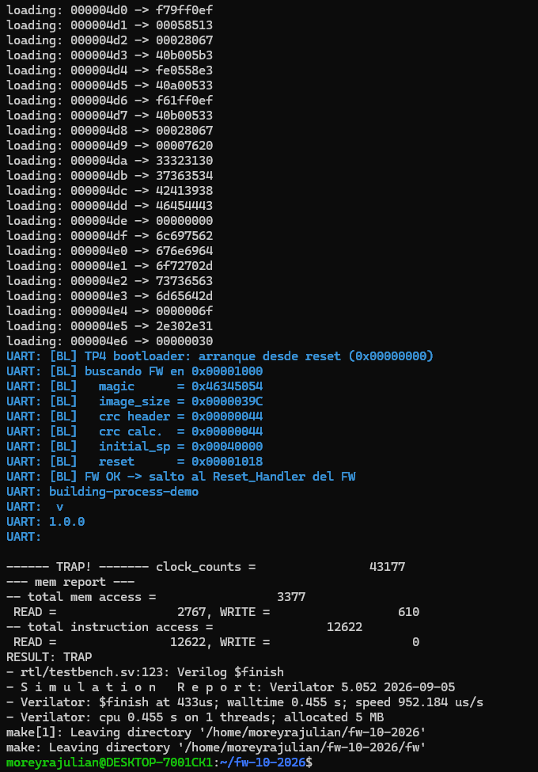
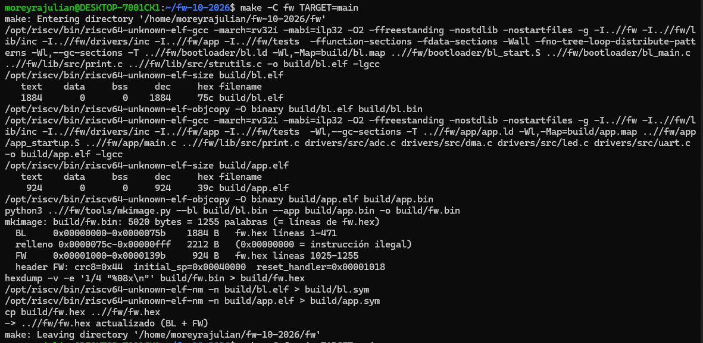
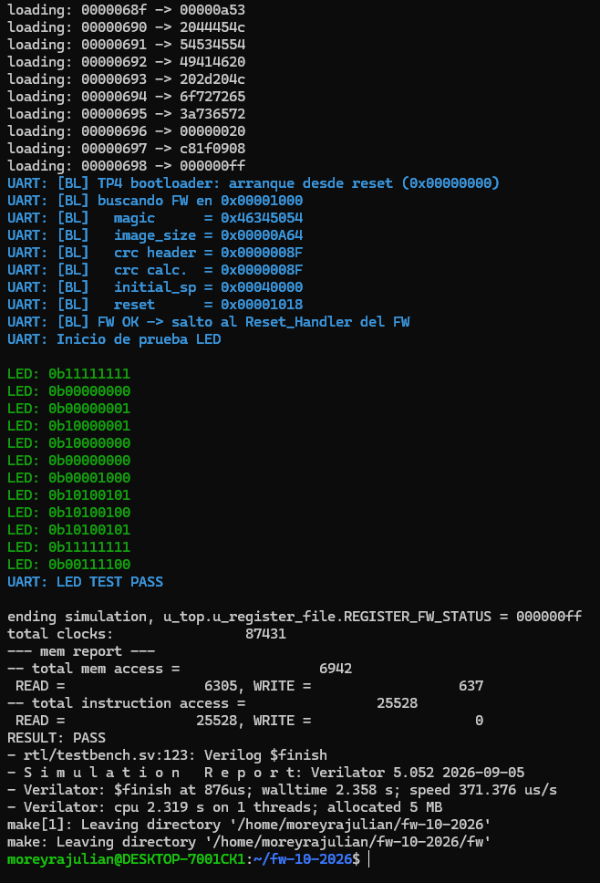

# Trabajo Práctico N°5: Drivers de periféricos

### Hito 1 - Preparación del proyecto

Se crearon los archivos base `.h` y `.c` de LED, UART, DMA y ADC, y se incorporaron las cuatro fuentes a `fw/sources.mk`. Luego de generar la configuración con `make build_project_config`, se ejecutó `make -C fw sim TARGET=main`.

La compilación terminó correctamente y la simulación ejecutó la aplicación base: el bootloader verificó el CRC del firmware y la aplicación imprimió `building-process-demo v1.0.0` por UART. El simulador informó `RESULT: TRAP`, consistente con el `ebreak` previsto en el startup cuando este `main` retorna sin establecer el estado de éxito.

**¿Por qué conviene separar interfaz pública en archivos `.h` e implementación en archivos `.c`?**

El archivo `.h` reúne las declaraciones de las funciones y los tipos públicos del driver. Permite que los módulos que lo utilizan conozcan los parámetros y valores de retorno, y que el compilador compruebe sus llamadas. El archivo `.c` contiene las definiciones de esas funciones y los detalles del acceso al hardware.

Cada archivo `.c` se compila por separado. Al incluir el mismo header tanto en la aplicación como en la implementación del driver, ambos utilizan una declaración común de la interfaz. El linker vincula las llamadas de la aplicación con las funciones compiladas del driver. Incluir el `.h` no incorpora automáticamente el `.c` a la compilación; por eso se agregaron las fuentes a `fw/sources.mk`.

Esta organización facilita modificar, probar y reutilizar cada driver sin mezclar responsabilidades. No es una obligación del lenguaje tener un par `.h`/`.c` por periférico: sería posible reunir todo en un único archivo `.c`. En este TP se utiliza un par por driver para cumplir la estructura solicitada y mantener módulos con responsabilidades claras. Los detalles internos pueden permanecer en el `.c`, y las funciones auxiliares declaradas `static` solo son accesibles desde esa unidad de compilación.

### Hito 2 - Driver LED

Se implementaron las ocho funciones de la interfaz LED, manteniendo
el acceso al registro encapsulado en `led.c`. Las operaciones utilizan
los ocho bits inferiores del registro.

Se creó `fw/tests/test_led.c` y se ejecutó:

    make -C fw sim TARGET=test_led

La prueba verificó inicialización, encendido, apagado, toggle,
escritura de patrones, consulta de estados individuales, limitación
a ocho bits e índices inválidos.

La simulación mostró `LED TEST PASS` y finalizó con `RESULT: PASS`.
El estado final observado fue `0b00111100`, equivalente a `0x3C`,
coincidente con el esperado.

**¿Qué política usaron para idx inválido y por qué?**

Para índices fuera del rango 0 a 7, las funciones de modificación
retornan sin acceder al registro. `led_get_status()` devuelve 0
sin acceder al hardware.

La validación se realiza antes del desplazamiento de bits, para
preservar el estado del periférico y evitar desplazamientos fuera
del rango permitido por C. El valor 0 devuelto por la consulta
no distingue entre un índice inválido y un LED apagado.

Se comprobaron los índices inválidos 8, 9, 31, 200 y 255,
verificando que el estado permaneciera en `0x3C`.

### Hito 3.a - Driver UART0

