# Trabajo Práctico N°5: Drivers de periféricos

## Hito 1 - Preparación del proyecto

Se crearon los archivos base `.h` y `.c` de LED, UART, DMA y ADC, y se incorporaron las cuatro fuentes a `fw/sources.mk`. Luego de generar la configuración con `make build_project_config`, se ejecutó `make -C fw sim TARGET=main`.

La compilación terminó correctamente y la simulación ejecutó la aplicación base: el bootloader verificó el CRC del firmware y la aplicación imprimió `building-process-demo v1.0.0` por UART. El simulador informó `RESULT: TRAP`, consistente con el `ebreak` previsto en el startup cuando este `main` retorna sin establecer el estado de éxito.

**¿Por qué conviene separar interfaz pública en archivos `.h` e implementación en archivos `.c`?**

El archivo `.h` reúne las declaraciones de las funciones y los tipos públicos del driver. Permite que los módulos que lo utilizan conozcan los parámetros y valores de retorno, y que el compilador compruebe sus llamadas. El archivo `.c` contiene las definiciones de esas funciones y los detalles del acceso al hardware.

Cada archivo `.c` se compila por separado. Al incluir el mismo header tanto en la aplicación como en la implementación del driver, ambos utilizan una declaración común de la interfaz. El linker vincula las llamadas de la aplicación con las funciones compiladas del driver. Incluir el `.h` no incorpora automáticamente el `.c` a la compilación; por eso se agregaron las fuentes a `fw/sources.mk`.

Esta organización facilita modificar, probar y reutilizar cada driver sin mezclar responsabilidades. No es una obligación del lenguaje tener un par `.h`/`.c` por periférico: sería posible reunir todo en un único archivo `.c`. En este TP se utiliza un par por driver para cumplir la estructura solicitada y mantener módulos con responsabilidades claras. Los detalles internos pueden permanecer en el `.c`, y las funciones auxiliares declaradas `static` solo son accesibles desde esa unidad de compilación.

## Hito 2 - Driver LED

Se implementaron las ocho funciones de la interfaz LED, manteniendo
el acceso al registro encapsulado en `led.c`. Las operaciones utilizan
los ocho bits inferiores del registro.

Se creó `fw/tests/test_led.c` y se ejecutó:

    make -C fw sim TARGET=test_led

La prueba verificó inicialización, encendido, apagado, toggle,
escritura de patrones, consulta de estados individuales, limitación
a ocho bits e índices inválidos.

La simulación mostró `LED TEST PASS` y finalizó con `RESULT: PASS`.
El estado final observado fue `0b00111100`, equivalente a `0x3C`,
coincidente con el esperado.

**¿Qué política usaron para idx inválido y por qué?**

Para índices fuera del rango 0 a 7, las funciones de modificación
retornan sin acceder al registro. `led_get_status()` devuelve 0
sin acceder al hardware.

La validación se realiza antes del desplazamiento de bits, para
preservar el estado del periférico y evitar desplazamientos fuera
del rango permitido por C. El valor 0 devuelto por la consulta
no distingue entre un índice inválido y un LED apagado.

Se comprobaron los índices inválidos 8, 9, 31, 200 y 255,
verificando que el estado permaneciera en `0x3C`.

## Hito 3.a - Driver UART0

Se implementaron `uart_init()`, `uart_write_byte()` y
`uart_write_str()`.

El driver utiliza polling bloqueante. Espera disponibilidad,
carga el buffer de salida, configura la cantidad de caracteres,
genera el pulso de inicio y espera hasta finalizar la transmisión.
Las cadenas se dividen en bloques de hasta 256 caracteres.

Los identificadores inválidos se ignoran. La función de envío de
cadenas retorna sin transmitir cuando recibe un puntero nulo o
una cadena vacía.

Se adaptó `print.c` para utilizar la interfaz pública del driver.
También se agregó `uart.c` a las fuentes del bootloader, que se
enlaza de manera independiente de la aplicación.

#### Validación

Se creó `fw/tests/test_uart0.c` y se ejecutó:

    make -C fw sim TARGET=test_uart0

Se verificó la transmisión de un carácter, una cadena, una cadena
vacía y una cadena de 260 caracteres. Esta última se transmitió
en bloques de 256 y 4 caracteres, cuyo contenido concatenado
coincidió con 26 repeticiones de `0123456789`.

Las llamadas con puntero nulo e identificador inválido finalizaron
sin contenido adicional observable. También se comprobó la
integración de `print_str()`, `print_chr()`, `print_dec()` y
`print_hex()`.

El bootloader validó el CRC del firmware con valor `0xEA`.
La simulación terminó con `REG_FW_STATUS = 0xFF` y `RESULT: PASS`.
El testbench comprobó la cantidad de bytes transmitidos y se
revisó el contenido del log.

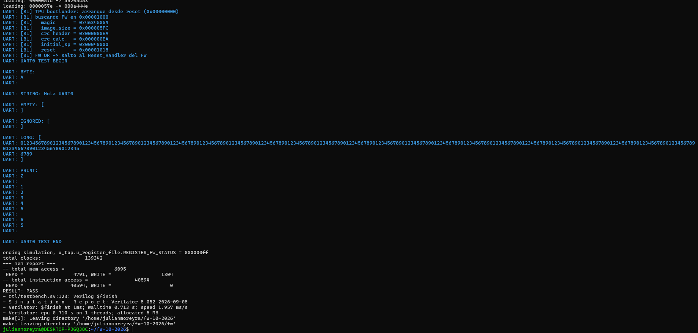

### Corrección de la interfaz pública

Se ajustó la API de UART0 a `uart_init(void)`, `uart_write_byte(char c)` y
`uart_write_str(const char *s)`.

Se actualizaron las llamadas de la biblioteca de impresión y
de la prueba UART0. Se retiró el caso de identificador inválido
y se conservó la comprobación del puntero nulo.

Esta corrección hace compatibles las firmas de UART0 con las
llamadas provistas en `test_drivers.c`.

#### Problemas encontrados

El enlace inicial del bootloader falló con una referencia
indefinida a `uart_write_str()`. Se resolvió incorporando
`uart.c` a `BL_SRC` y guardando el Makefile.

## Hito 3.b - Driver UART1 serie

Se implementó el driver UART1 tomando como referencia el datasheet.

UART1 utiliza formato 8N1 y FIFOs de transmisión y recepción de
16 bytes. Se configuró `BAUD_DIV = 32`, equivalente a 32 ciclos
de reloj por bit.

La inicialización programa el divisor y escribe un valor conocido
en `CTRL`, dejando RTS desactivado y limpiando los errores.
La aplicación de prueba activa RTS posteriormente.

La recepción es no bloqueante. `uart1_getc()` lee `RX_DATA` una
sola vez y comprueba el bit `VALID` en el valor obtenido, ya que
cada lectura válida consume un byte de la FIFO.

La transmisión espera espacio en la FIFO TX antes de escribir.

Se incorporó `uart1.c` a `fw/sources.mk` y se agregó el target
`test_uart_serial` al Makefile raíz para ejecutar el guion
provisto y comprobar el resultado del simulador.

### Validación

Se ejecutó:

    make test_uart_serial

El bootloader validó el firmware con CRC `0x98`.
El guion verificó:

- Anuncio de arranque mediante `K`.
- Eco de los 256 valores entre `00` y `FF`.
- Eco del patrón `A5 5A 00 FF 5A A5`.
- Detección de framing error.
- Detección de overrun.
- Limpieza de los indicadores de error.

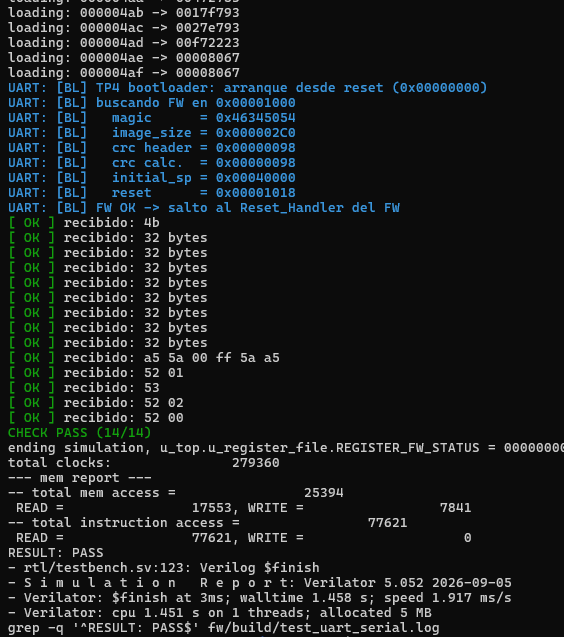

La simulación finalizó con:

    CHECK PASS (14/14)
    RESULT: PASS

### Problemas encontrados y correcciones

La primera simulación presentó corrupción en el eco. La captura
mostró que el segundo byte enviado, `0x40`, ingresaba a la FIFO
RX como `0xA0`.

Se corrigió `host_send_byte()` en `rtl/uart1_host.svh`.
Después del bit de parada había una escritura redundante de
la línea RX a uno que coincidía con el inicio del siguiente
carácter cuando `gap = 0`. Esa escritura se limitó al caso
de bit de parada incorrecto, que necesita recuperar el nivel
de reposo para resincronizar el receptor.

Con esta corrección del entorno de prueba, el mismo firmware
completó las 14 verificaciones.

## Hito 4 - Driver DMA

Se implementaron `dma_init()`, `dma_copy()` y `dma_is_done()`.
La configuración de origen, destino, cantidad de palabras y
activación de START quedó encapsulada en `dma.c`.

La copia es bloqueante. El driver configura la transferencia,
genera un flanco de inicio escribiendo START en cero y luego
en uno, y espera a que DONE indique finalización.

La longitud se expresa en palabras de 32 bits. Se comprueba
la alineación de ambas direcciones y que los bloques completos
queden dentro del mapa direccionable. La validación evita
desbordamientos aritméticos al comprobar la longitud.

Las solicitudes con longitud cero, direcciones inválidas o
bloques solapados retornan sin iniciar una transferencia.
La interfaz devuelve `void`, por lo que estos rechazos no
proporcionan un código de error.

### Validación

Se creó `fw/tests/test_dma_driver.c`, que controla el DMA
mediante su interfaz pública, y se ejecutó:

    make -C fw sim TARGET=test_dma_driver

Se comprobaron:

- Copias de 1, 2, 16, 255, 256 y 1000 palabras.
- Coincidencia del contenido de destino.
- Conservación del origen y de las posiciones externas al bloque.
- Indicador DONE después de cada copia.
- Transferencias consecutivas.
- Longitud cero.
- Direcciones desalineadas y fuera del mapa.
- Bloques que exceden el final del mapa.
- Longitud extrema `UINT32_MAX`.
- Solapamiento en ambos sentidos y origen igual al destino.
- Una copia válida posterior a las solicitudes rechazadas.

El bootloader verificó el CRC `0xDB`. La simulación mostró:

    DMA TEST PASS
    RESULT: PASS

El estado final fue `REG_FW_STATUS = 0xFF`.

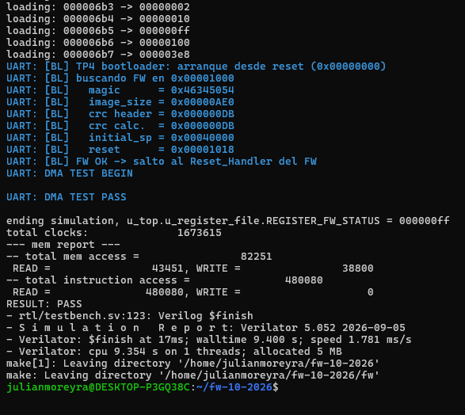

### Decisiones y correcciones

Se corrigió la validación que rechazaba la dirección cero,
porque `0x00000000` corresponde a memoria de instrucciones
válida en esta plataforma.

La prueba realizada cubre copias entre arreglos en RAM.
Las transferencias desde dirección física cero y con registros
de periféricos quedan fuera de su cobertura.

### ¿Qué pasa si dst y src se solapan?

El hardware copia palabras hacia direcciones crecientes.
Un destino que comienza dentro del bloque origen puede
sobrescribir palabras que todavía deben leerse.

Se eligió rechazar cualquier solapamiento, incluyendo origen
igual al destino. El driver retorna antes de activar START.
Las pruebas comprobaron que los arreglos conservaran su
contenido en estos casos.

## Hito 5 - Driver ADC

Se implementaron `adc_init()`, `adc_start()`, `adc_half_done()`,
`adc_done()` y `adc_read()`. Se conservó `set_adc_clk_divider()`, utilizada por la versión
anterior de la prueba integrada. El test oficial actualizado
configura el divisor mediante `adc_init()`.

El acceso a los registros quedó encapsulado en `adc.c`.

Se utilizaron muestras `uint32_t`, de acuerdo con la interfaz
requerida y con el buffer de 32 bits del hardware. Se corrigió
así la incompatibilidad con el ejemplo de la consigna, que
declaraba un arreglo `uint16_t`.

`adc_read()` inicia una adquisición única completa, espera su
finalización y copia al destino hasta 256 muestras. Devuelve
la cantidad copiada. Para puntero nulo o longitud cero retorna
cero sin iniciar una adquisición.

`adc_half_done()` y `adc_done()` realizan esperas bloqueantes
sobre los indicadores de mitad y finalización de captura,
respectivamente. `adc_half_done()` debe llamarse después de
iniciar la adquisición y antes de que termine, porque el RTL
desactiva el indicador de mitad al completar la captura.

La configuración y el inicio requieren el ADC inactivo.

### Validación

Se creó `fw/tests/test_adc_driver.c` y se ejecutó con divisores
4 y 16:

    make -C fw sim TARGET=test_adc_driver

La prueba comprobó:

- Puntero nulo y longitud cero.
- Lecturas de 1, 16, 64, 100 y 256 muestras.
- Limitación a 256 muestras cuando se solicitan 260.
- Conservación de las posiciones externas al bloque de destino.
- Adquisiciones consecutivas.
- Variación entre muestras.
- Impresión de un bloque completo por UART.

Ambas ejecuciones finalizaron con:

    ADC TEST PASS
    RESULT: PASS

Se imprimió cada muestra como una cadena decimal completa para
que el script `fw/tools/plot_adc.py` pudiera extraer un valor
por línea. Se obtuvieron exactamente 256 valores por ejecución.

### Comparación de divisores

Los códigos se convirtieron a voltaje mediante:

    voltaje = muestra * 3.3 / (2**32 - 1)

Con divisor 4 se observaron aproximadamente tres períodos
en las 256 muestras.

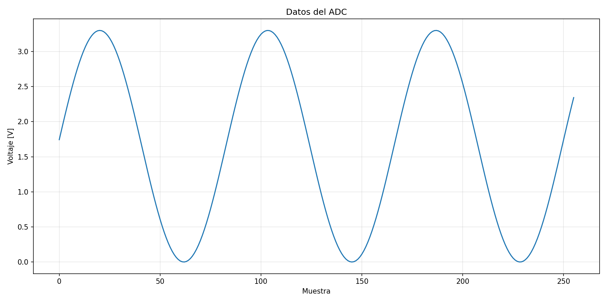

Con divisor 16 se observaron aproximadamente doce períodos.

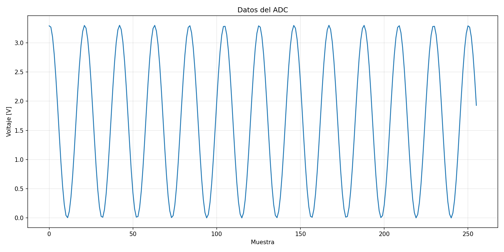

Al aumentar el divisor de 4 a 16, el intervalo entre muestras
se multiplica por cuatro. Para una cantidad fija de muestras,
la captura abarca una ventana temporal cuatro veces mayor.

Para obtener ambas capturas se configuró `TEST_DIVIDER` en
`fw/tests/test_adc_driver.c` primero en 4 y luego en 16,
guardando y recompilando en cada ejecución. La versión final
del archivo conserva el valor 16.

El RTL local utiliza una señal de 300 kHz como valor
predeterminado, diferente del valor de 1 MHz mencionado
en el datasheet.

## Hito 6 - Integración en aplicación de demo

Se reemplazó la aplicación base por una demo que integra los
drivers LED, UART0, DMA y ADC mediante sus interfaces públicas.

La aplicación realiza las siguientes operaciones:

1. Inicializa los periféricos y enciende el LED 0.
2. Copia 32 palabras mediante DMA, verifica el destino y la
   conservación del origen, y enciende el LED 1.
3. Adquiere 256 muestras ADC con divisor 4, comprueba la
   cantidad y la variación entre muestras, y enciende el LED 2.
4. Enciende el LED 3, verifica el estado final `0x0F` y
   comunica el éxito por UART0.

Ante una comprobación fallida, la demo informa el motivo,
establece los LED en `0x80` y comunica el fallo al testbench.

Se agregó `fw_finish()` como función de soporte para encapsular
la escritura de `REG_FW_STATUS`. La aplicación queda libre
de accesos directos a registros.

### Validación

Se ejecutó:

    make -C fw sim TARGET=main

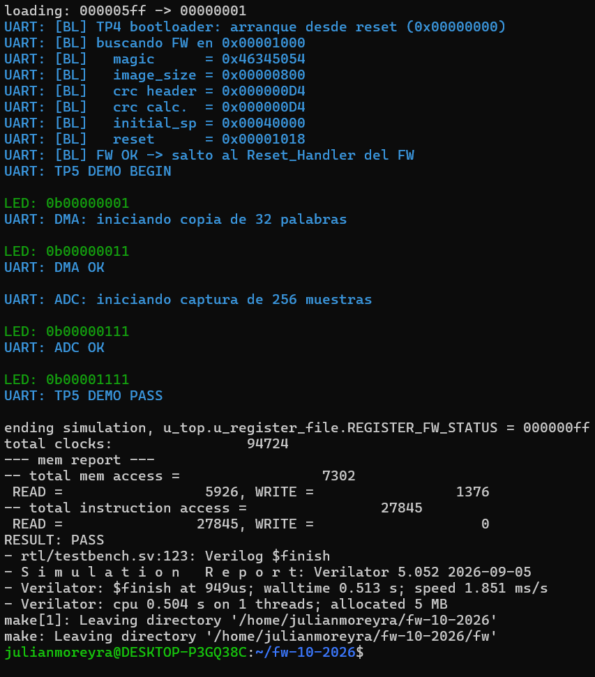

El bootloader verificó el CRC `0xD4`. Se observaron los mensajes
`DMA OK`, `ADC OK` y `TP5 DEMO PASS`.

Los LED mostraron la progresión:

    0x01 → 0x03 → 0x07 → 0x0F

La simulación terminó con `REG_FW_STATUS = 0xFF` y:

    RESULT: PASS

La demo utiliza UART0 para los mensajes de estado. UART1 cuenta
con la validación específica realizada en el hito 3.b.

## Hito 7 - Cierre y validación final

Se realizó una reconstrucción desde cero y se ejecutó la
prueba integrada provista por la cátedra, `test_drivers.c`.

Se utilizaron los siguientes comandos desde la raíz del
repositorio:

    make clean
    make build_project_config
    make fw TARGET=test_drivers
    make sim

La limpieza eliminó los productos de compilación del firmware
y del simulador. Luego se regeneró la configuración y se
reconstruyeron el bootloader, la aplicación y el simulador.

El bootloader verificó la imagen del firmware con CRC esperado
y calculado iguales a `0x70`.

La prueba integrada comprobó LED, DMA, UART0 y ADC mediante
las interfaces de los drivers. No se observaron identificadores
de falla `Txx`.

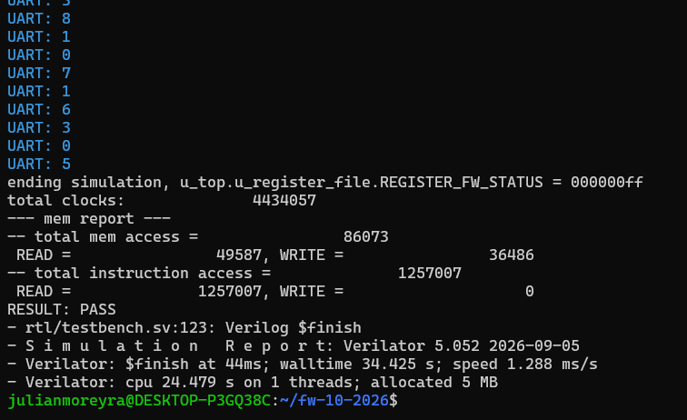

La simulación finalizó con:

    REG_FW_STATUS = 000000ff
    RESULT: PASS

UART1 cuenta con la validación específica del hito 3.b,
que completó `CHECK PASS (14/14)`.

Con esta ejecución se completó la validación final solicitada
por la consigna.

### Adaptación del ADC

Se modificó `adc_half_done()` para que espere mediante polling
hasta la activación del indicador de mitad de captura.

Se corrigió `ADC_MODE_CIRCULAR` a `3`, combinando el bit de
inicio y el bit de modo circular.

Se agregó una comprobación de media captura con divisor 255:
al retornar `adc_half_done()`, el indicador de mitad estaba
activo y la adquisición todavía no había finalizado. Luego se
esperó su finalización mediante `adc_done()`.

La prueba ADC terminó con `ADC TEST PASS` y `RESULT: PASS`,
con CRC esperado y calculado iguales a `0xD9`.
Esta prueba utiliza captura única; no valida el funcionamiento
continuo del modo circular.

### Validación posterior a la actualización

Se ejecutaron:

    make clean
    make build_project_config
    make fw TARGET=test_drivers
    make sim
    make test_uart_serial
    make -C fw sim TARGET=main

Resultados:

| Prueba | Resultado | CRC |
|---|---|---|
| Test integrado actualizado | PASS, sin identificadores de falla Txx | 0x1C |
| UART1 | CHECK PASS (14/14) y RESULT: PASS | 0x98 |
| Demo integrada | TP5 DEMO PASS y RESULT: PASS | 0x49 |

La demo mostró `DMA OK`, `ADC OK` y la progresión de LED
`0x01 → 0x03 → 0x07 → 0x0F`.

Estas ejecuciones complementan la evidencia de los hitos
anteriores y corresponden a la versión actualizada del TP5.

### Evidencia de las nuevas ejecuciones

**ADC: validación de la espera hasta media captura**

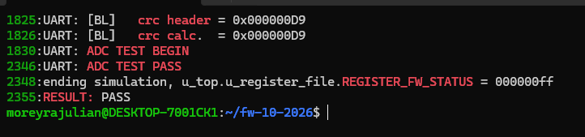

**Prueba integrada actualizada**

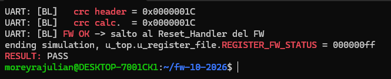

**UART1 después de integrar los cambios**

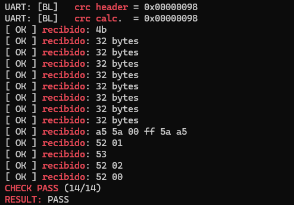

**Demo integrada después de la actualización**

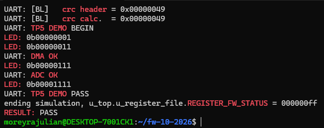